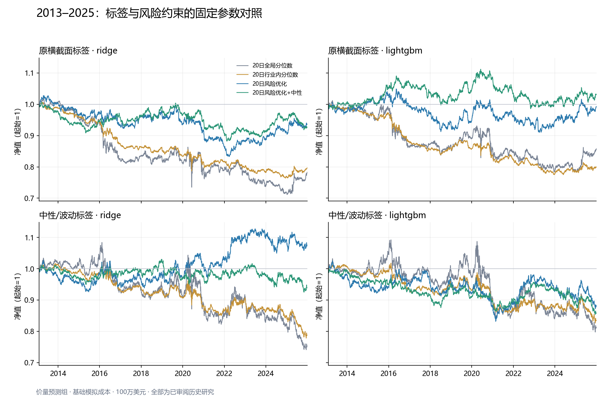

# 标签中性化、风险中性与长窗口研究（2026-10-23）

基准：[阶段报告](STAGE_REPORT_2026-10-23.md)、[降换手研究](TURNOVER_OPTIMIZATION_2026-10-23.md)。本次新增源码和独立产物，没有覆盖旧OOF或旧执行账本。

已完成八个模型分支、64个完整组合/费用账本及配对检验。结果先行：

- 新标签在16个匹配组合中有 **12/16** 个净Sharpe点估计提高，**0/16** 个未校正95%配对区间完全为正；不能据此默认全面替换原标签。八个分支原始收益IC的最大绝对HAC t仅为 **0.71**。
- 加入beta/行业硬中性，在 **8/8** 个匹配组降低持仓估计abs(beta)的P95，**7/8** 个降低最大净回撤，**1/8** 个提高净Sharpe。控制指定敞口与改善总收益是不同的验收项。
- 基础费用下32个固定组合中有 **3个** 净年化为正，双倍费用下32个组合中有 **0个** 为正。当前结果没有提供足以全面替换默认方案的稳健盈利证据。
- 拉长窗口确实提高精度：原标签/价量Ridge分位数组合的Sharpe区块标准误从最近4年的 **0.503** 降至全窗口的 **0.236**。这仍是已审阅历史研究，不构成新的独立盈利证明。

## 1. 必要性判断与前提纠正

三个方向值得实施为可审计的对照实验；标签和风险约束是否替换默认方案，必须看净收益、敞口与配对不确定性，不能先认定它们会改善盈利或消除大部分回撤。

- **标签已有横截面处理。** 原实现是按日去均值/标准差缩放并截尾，不是直接拿原始20日收益拟合。`zscore(r_i-r_market)=zscore(r_i)`，当天共同标量市场收益相减没有新增作用；它也不能消除股票之间不同beta带来的市场暴露。新实验加入的是个股事前波动缩放与行业/规模联合投影。
- **回撤/波动比不能归因。** 最大回撤是路径统计，年化波动是收益分布统计，2.5倍的比值本身不能证明某次行业或动量反转造成了回撤。本轮保存实际beta、行业净额和条件风险模型的收益分解，再检查这些解释。
- **10%目标不保证更小回撤。** 无费用的正固定倍数缩放不会改变Sharpe，动态波动管理则是需要实证检验的策略。[Moreira–Muir](https://www.nber.org/papers/w22208)提供研究动机，并不保证本项目收益。当前目标gross上限为1，10%是调仓目标的事前波动上限；不加杠杆强行命中10%，不把它当作最大回撤承诺。
- **长窗口有必要。** 年度Sharpe精度不能只按年数机械认定，序列相关会影响推断，见[Lo的研究](https://papers.ssrn.com/sol3/papers.cfm?abstract_id=377260)。本轮同时给出长窗口和最近4年的区块抽样误差。

## 2. 长窗口及公平比较

实际预测期为 **2013-02-04—2025-12-31，3,248个交易日，13个预测折**；首日由756个训练日和20日标签清除边界决定，不能虚构2013年1月预测。最后一折224个交易日保留。

八个标签/信息组/模型分支各有 **1,634,013** 个相同预测键；共同训练标签有效比例为85.84%。标签缺失或小行业只影响训练准入，不删除当日可生成预测的证券。外层与内层均按真实`label_end`严格清除交叠，所有模型、信息组和标签分支共享同折同阶段的抽样键。

为避免用2021年的数据替2013年选特征，特征质量门槛锁定于 **2012-06-05** 之前。价量组为37个、加入财务为42个；早期覆盖不足而排除的是 **RESID_MOM_12_1M, PIOTROSKI_F8**。因此新实验与旧38/44特征、后期锁定的四年实验不是“只延长日期”的严格单变量比较；后期可用信息被固定早期schema保守约束，这也是结果解释边界。

共16个预声明标签/信息组/模型候选配置、312条内层候选/外层重拟合记录、624次实际含种子的单模型拟合。Ridge和LightGBM沿用原有两组候选；20日原始收益IC用于内层选择，外层标签不参与选参。所有2013–2025结果均标记为已审阅或审阅状态未知的历史walk-forward研究，**不宣称新、未触碰的独立holdout**。

## 3. 标签实现

新标签使用严格截至t−1的60交易日个股日收益波动，最少40条观测，日波动下限0.5%；分母为该波动乘sqrt(20)。先缩放前瞻收益，再对按历史有效日期对齐的行业哑变量及滞后log市值作联合投影；行业至少5个有效标签。行业对齐不代表拥有当时发布版本，PIT限制仍在。若先投影后除以不同股票的波动，会重新引入暴露，因此本实现调整了运算顺序。

投影后按日标准化、截尾到±3，再次联合投影，最后只做同日公共的向下缩放以守住±3。这样稳健处理后仍保持行业/规模正交（浮点精度内），但不要求最终方差恰为1。行业和市值来自原`decision_*`字段，不重复滞后；未来收益只用于训练标签与事后评估，不进入预测特征。

| 标签 | 信息组 | 模型 | 20日原始收益Rank IC | HAC t | 有标签评估日 |
| --- | --- | --- | --- | --- | --- |
| 原横截面标签 | price_only | ridge | 0.00223 | 0.30 | 3228 |
| 原横截面标签 | price_plus_financial | ridge | -0.00050 | -0.06 | 3228 |
| 中性/波动标签 | price_only | ridge | -0.00078 | -0.08 | 3228 |
| 中性/波动标签 | price_plus_financial | ridge | -0.00009 | -0.01 | 3228 |
| 原横截面标签 | price_only | lightgbm | 0.00459 | 0.71 | 3228 |
| 原横截面标签 | price_plus_financial | lightgbm | 0.00342 | 0.41 | 3228 |
| 中性/波动标签 | price_only | lightgbm | 0.00331 | 0.31 | 3228 |
| 中性/波动标签 | price_plus_financial | lightgbm | 0.00438 | 0.40 | 3228 |

HAC至少使用19阶滞后以容纳20日标签重叠，保留缺失日期间隔。这里的t统计没有校正历史研究选择。标签端处理不保证原始收益IC统一提高；残差动量和特征端中性化的历史表现不能替代标签端的直接证据。

## 4. 风险模型与实际执行

- 市场代理为历史合格股票池的等权收益，并非官方市值加权指数；SMB按前日公司市值划分。风险行业因子使用日期对应的宽SIC分区2–8超额收益，组合硬约束使用更细的历史SIC2行业，不把今天的分类回填历史。beta=0是相对于此市场代理的估计约束。
- 每日风险估计使用t之前最多252个交易日，至少126个有效观测；风险因子协方差半衰期60日、50%对角收缩；个股特异年化波动下限1%。复用`FactorRiskModel`并保留Euler核对，修复nullable数值转object矩阵的问题，并按共同缺失掩码批量回归。
- 原优化器的gross=2及复权价差分路径不直接用于本实验。新路径用CIZ直接总收益，调仓目标约束为gross≤1、个股≤1.5%、发行人≤3%、净美元敞口0；中性分支再约束滚动单因子市场beta=0和每个SIC2行业净额=0。行业资金中性不等于每个连续行业风险因子的beta也恰为0；规模因子进入协方差，没有额外强制规模beta=0。
- [OSQP凸二次规划](https://osqp.org/docs/interfaces/python.html)直接使用因子形式，避免每天构造稠密股票协方差。分数按固定10%年化横截面收益差先验换算到日收益单位，风险厌恶3、20日预测期、每成交美元10bps的L1换手代理；它不是已校准的收益预测或真实券商费率。
- 换手惩罚参照当日标记的实际持仓，绝非昨日目标。实际成交仍独立支付原佣金/最低佣金/滑点/冲击/卖出费用/借券。压力情景实际费用整体翻倍，优化器固定10bps代理不重调参，保留NAV与成交路径反馈。
- 四种正式构造统一沿用原模型20交易日的调仓日历，逐日估计/记录实际风险。两个分位数组合使用原始分数；两个风险优化组合共同使用EMA5，仅中性约束不同。它们使用同一事前风险可覆盖的预测股票池。行业内分位数组合遇到不可构造双边的小行业持现金，限制后只缩小较大一侧以保留行业净额0。
- 目标波动缩放仅向下，遵守gross/个股/发行人目标上限；目标与实际敞口均保存。整数成交、停牌和参与率可能留下实际残余敞口，期间收益与费用也会使实际gross超过目标上限，表中同时列出平均及最大实际gross。共同20日日历没有额外每日强平规则，不能把目标中性或目标上限说成持续精确的实际约束。

基础费用的16个风险优化账本合计有 **0次** 调仓触发10%事前波动上限。若未触发，风险变化应归因于组合权重、协方差惩罚与中性约束，不能归功于未实际生效的波动缩放。

早期风险QP有7次完整窗口任务在数值约束检查时失败，记录保留在原`failures.json`。中间运行因求解效率问题中断，另存`run_interrupted.json`，随后加入求解器热启动与统一向下可行性缩放。为避免将风险约束和交易频率一起改变，正式对照另行登记为共同20日日历，完整重跑64个任务；每日模式由`--risk-sessions 1`显式开启，先前每日接口运行不列作完整收益证据。本轮不宣称已做到两次调仓之间持续精确beta/行业中性，期间实际漂移见表和账本。未放宽风险限制、未静默切换策略；失败与中断运行不用于选策略参数。

## 5. 全部净收益与风险结果

下表保留全部固定方案，未按最大收益挑选默认策略；行业净额绝对和是各SIC2净权重绝对值之和，beta为事前滚动市场代理的估计暴露。费用是假设历史模拟成本，非2013–2025真实成交校准结果。

| 标签 | 信息组/模型 | 组合 | 净年化 | 净Sharpe | 最大净回撤 | 净年化波动 | 平均实际gross | 最大实际gross | 持仓估计abs(beta)P95 | 行业净额绝对和P95 | 年化交易拖累 | 双倍成本净年化 |
| --- | --- | --- | --- | --- | --- | --- | --- | --- | --- | --- | --- | --- |
| 原横截面标签 | price_only/lightgbm | 20日行业内分位数 | -1.72% | -0.583 | 22.48% | 2.90% | 0.882 | 1.031 | 0.1625 | 3.31% | 1.05% | -3.00% |
| 原横截面标签 | price_only/lightgbm | 20日全局分位数 | -1.18% | -0.206 | 22.57% | 5.13% | 1.020 | 1.260 | 0.2511 | 61.36% | 1.16% | -2.64% |
| 原横截面标签 | price_only/lightgbm | 20日风险优化 | -0.06% | 0.007 | 13.23% | 4.09% | 1.015 | 1.172 | 0.1114 | 65.78% | 0.55% | -0.87% |
| 原横截面标签 | price_only/lightgbm | 20日风险优化+中性 | 0.24% | 0.085 | 11.35% | 3.56% | 1.016 | 1.163 | 0.0228 | 4.67% | 0.58% | -0.59% |
| 原横截面标签 | price_only/ridge | 20日行业内分位数 | -1.74% | -0.556 | 24.04% | 3.07% | 0.881 | 1.012 | 0.1603 | 3.65% | 1.12% | -3.09% |
| 原横截面标签 | price_only/ridge | 20日全局分位数 | -1.88% | -0.304 | 30.53% | 5.70% | 1.017 | 1.242 | 0.2838 | 67.89% | 1.27% | -3.43% |
| 原横截面标签 | price_only/ridge | 20日风险优化 | -0.51% | -0.115 | 18.92% | 3.85% | 1.018 | 1.143 | 0.1359 | 70.96% | 0.60% | -1.38% |
| 原横截面标签 | price_only/ridge | 20日风险优化+中性 | -0.59% | -0.173 | 12.39% | 3.11% | 1.015 | 1.120 | 0.0178 | 4.99% | 0.63% | -1.46% |
| 原横截面标签 | price_plus_financial/lightgbm | 20日行业内分位数 | -1.37% | -0.418 | 19.97% | 3.19% | 0.884 | 1.048 | 0.1548 | 3.66% | 0.92% | -2.56% |
| 原横截面标签 | price_plus_financial/lightgbm | 20日全局分位数 | -2.05% | -0.316 | 26.98% | 5.97% | 1.019 | 1.255 | 0.2508 | 70.07% | 1.00% | -3.37% |
| 原横截面标签 | price_plus_financial/lightgbm | 20日风险优化 | -0.02% | 0.015 | 16.02% | 4.12% | 1.013 | 1.159 | 0.1056 | 69.29% | 0.40% | -0.70% |
| 原横截面标签 | price_plus_financial/lightgbm | 20日风险优化+中性 | -0.28% | -0.061 | 13.34% | 3.58% | 1.013 | 1.143 | 0.0220 | 4.70% | 0.43% | -0.95% |
| 原横截面标签 | price_plus_financial/ridge | 20日行业内分位数 | -2.12% | -0.649 | 27.41% | 3.23% | 0.882 | 1.013 | 0.1685 | 3.59% | 1.09% | -3.44% |
| 原横截面标签 | price_plus_financial/ridge | 20日全局分位数 | -2.03% | -0.301 | 30.23% | 6.16% | 1.018 | 1.266 | 0.3111 | 75.37% | 1.21% | -3.57% |
| 原横截面标签 | price_plus_financial/ridge | 20日风险优化 | -0.59% | -0.130 | 17.01% | 3.95% | 1.018 | 1.127 | 0.1384 | 77.65% | 0.51% | -1.36% |
| 原横截面标签 | price_plus_financial/ridge | 20日风险优化+中性 | -0.67% | -0.192 | 14.35% | 3.25% | 1.016 | 1.125 | 0.0199 | 5.28% | 0.56% | -1.49% |
| 中性/波动标签 | price_only/lightgbm | 20日行业内分位数 | -1.39% | -0.322 | 18.79% | 4.08% | 0.884 | 1.027 | 0.2102 | 3.92% | 0.83% | -2.47% |
| 中性/波动标签 | price_only/lightgbm | 20日全局分位数 | -1.59% | -0.191 | 26.95% | 7.07% | 1.021 | 1.238 | 0.3440 | 65.86% | 0.88% | -2.72% |
| 中性/波动标签 | price_only/lightgbm | 20日风险优化 | -0.97% | -0.192 | 18.88% | 4.54% | 1.013 | 1.118 | 0.1871 | 69.22% | 0.35% | -1.57% |
| 中性/波动标签 | price_only/lightgbm | 20日风险优化+中性 | -1.19% | -0.310 | 14.60% | 3.63% | 1.014 | 1.115 | 0.0246 | 5.12% | 0.40% | -1.83% |
| 中性/波动标签 | price_only/ridge | 20日行业内分位数 | -1.83% | -0.436 | 23.75% | 4.04% | 0.884 | 1.011 | 0.2181 | 3.84% | 0.90% | -2.95% |
| 中性/波动标签 | price_only/ridge | 20日全局分位数 | -2.16% | -0.255 | 31.61% | 7.46% | 1.020 | 1.245 | 0.3787 | 72.11% | 0.98% | -3.40% |
| 中性/波动标签 | price_only/ridge | 20日风险优化 | 0.57% | 0.151 | 9.83% | 4.42% | 1.014 | 1.132 | 0.1845 | 71.05% | 0.41% | -0.12% |
| 中性/波动标签 | price_only/ridge | 20日风险优化+中性 | -0.49% | -0.116 | 10.17% | 3.65% | 1.014 | 1.136 | 0.0217 | 5.16% | 0.44% | -1.18% |
| 中性/波动标签 | price_plus_financial/lightgbm | 20日行业内分位数 | -0.72% | -0.151 | 13.95% | 4.19% | 0.882 | 1.025 | 0.2167 | 3.79% | 0.77% | -1.75% |
| 中性/波动标签 | price_plus_financial/lightgbm | 20日全局分位数 | -1.36% | -0.161 | 24.20% | 7.02% | 1.018 | 1.230 | 0.3425 | 66.79% | 0.82% | -2.43% |
| 中性/波动标签 | price_plus_financial/lightgbm | 20日风险优化 | -0.52% | -0.094 | 14.17% | 4.49% | 1.012 | 1.113 | 0.1902 | 66.37% | 0.31% | -1.11% |
| 中性/波动标签 | price_plus_financial/lightgbm | 20日风险优化+中性 | -0.52% | -0.126 | 12.99% | 3.64% | 1.013 | 1.120 | 0.0235 | 5.13% | 0.37% | -1.14% |
| 中性/波动标签 | price_plus_financial/ridge | 20日行业内分位数 | -1.36% | -0.319 | 17.93% | 4.05% | 0.884 | 1.025 | 0.2133 | 3.90% | 0.88% | -2.48% |
| 中性/波动标签 | price_plus_financial/ridge | 20日全局分位数 | -1.91% | -0.230 | 28.98% | 7.24% | 1.020 | 1.246 | 0.3670 | 73.60% | 0.97% | -3.13% |
| 中性/波动标签 | price_plus_financial/ridge | 20日风险优化 | 0.04% | 0.032 | 11.78% | 4.48% | 1.015 | 1.129 | 0.1808 | 71.97% | 0.38% | -0.63% |
| 中性/波动标签 | price_plus_financial/ridge | 20日风险优化+中性 | -0.15% | -0.025 | 10.75% | 3.60% | 1.014 | 1.133 | 0.0222 | 4.88% | 0.42% | -0.83% |



## 6. 不确定性、阶段表现与收益归因

固定种子2718、60交易日循环区块、1,500次配对抽样。另保存20和126交易日块的单组合区间敏感性；配对比较以预设60日块为准。区间条件于已生成预测及执行路径，没有重新训练每个bootstrap样本，也没有校正全部历史研究选择或全部比较的多重检验。

| 标签 | 信息组/模型 | 长窗口净Sharpe | 95%区块区间 | 长窗口SE | 最近4年SE | 20/60/126日块SE范围 |
| --- | --- | --- | --- | --- | --- | --- |
| 原横截面标签 | price_only/lightgbm | -0.206 | [-0.680, 0.298] | 0.249 | 0.522 | 0.228–0.257 |
| 原横截面标签 | price_only/ridge | -0.304 | [-0.761, 0.168] | 0.236 | 0.503 | 0.221–0.251 |
| 原横截面标签 | price_plus_financial/lightgbm | -0.316 | [-0.794, 0.158] | 0.250 | 0.551 | 0.238–0.260 |
| 原横截面标签 | price_plus_financial/ridge | -0.301 | [-0.777, 0.153] | 0.241 | 0.519 | 0.232–0.255 |
| 中性/波动标签 | price_only/lightgbm | -0.191 | [-0.652, 0.314] | 0.244 | 0.452 | 0.231–0.264 |
| 中性/波动标签 | price_only/ridge | -0.255 | [-0.722, 0.238] | 0.241 | 0.459 | 0.221–0.258 |
| 中性/波动标签 | price_plus_financial/lightgbm | -0.161 | [-0.634, 0.336] | 0.247 | 0.428 | 0.231–0.268 |
| 中性/波动标签 | price_plus_financial/ridge | -0.230 | [-0.700, 0.240] | 0.243 | 0.478 | 0.226–0.263 |

| 配对类型 | 配对数 | 未校正95%区间完全为正 | 未校正95%区间完全为负 |
| --- | --- | --- | --- |
| financial | 16 | 1 | 0 |
| industry_ranking | 8 | 0 | 3 |
| label | 16 | 0 | 0 |
| model | 16 | 0 | 0 |
| neutrality | 8 | 0 | 0 |

完整配对区间位于`paired_comparisons.csv`，分别覆盖标签、Ridge/LightGBM、财务增量、行业内排序和风险中性；不能仅凭点估计或年数宣称已区分模型。

以下预先固定的原标签/价量Ridge参照组用于展示阶段差异，各阶段为区间累计净收益，并非对事件的因果归因；其他七组完整保留在CSV。

| 阶段（原标签/价量Ridge） | 20日全局分位数 | 20日行业内分位数 | 20日风险优化 | 20日风险优化+中性 |
| --- | --- | --- | --- | --- |
| 2015–2016 | -13.54% | -9.03% | -3.09% | 1.93% |
| 2018 | -0.03% | -0.10% | 2.12% | 3.16% |
| 2020 | -2.29% | -2.37% | -2.03% | -1.40% |
| 2022–2023 | -6.58% | -4.08% | 2.63% | 0.72% |
| 2022-11—2023-01 | -2.25% | -1.39% | 0.96% | -0.31% |
| 2023银行事件月 | -2.69% | -0.81% | -1.52% | -0.85% |

`regime_comparison.csv`单列2015–2016、2018、2020、2022–2023、2022-11—2023-01及2023年3月；`factor_return_attribution.csv`以昨日收盘实际因子暴露乘当日已实现因子收益，记录市场/规模/行业分量及剩余。它是条件风险模型的统计分解，因子相关且不是事件因果识别。出现无法建模持仓时明确标记覆盖缺口；新模型结果也不等同于旧四年冻结OOF的事件损益。

## 7. 验证与复现

- 506项全工作区测试通过；新测试覆盖标签市场平移不变性、稳健后行业/规模正交、波动率前缀不变、日期锚定及最后短折、共同抽样/清除边界、nullable风险数据、日期行业图、QP中性/上限、波动缩放与实际持仓回调。
- 64个最终账本核对整股、零费用拒单、参与率、来源费用加总及逐日NAV恒等式。模型预测键/抽样键一致；全部风险观察严格早于决策日；因子协方差最小特征值为0.000474。
- `classification_is_point_in_time=false`、`fundamentals_is_point_in_time=false`仍保留。这里是有效日期历史分类与修订版财务的受限研究；价量信息组的预测特征不含财务字段，组合风险上下文在两组间一致。
- 仍未建立独立股数/现金/公司行为第二账本、真实借券准入、多资金容量或新未触碰检验期的稳健盈利证据；`production_admitted=false`。
- 原始授权数据和旧报告产物保持独立。模型、风险缓存和执行阶段分别记录输入/源码哈希及源码快照；不同数值修复阶段有独立产物，未冒称仅凭未提交Git版本即可复现。

本地产物：`data/wrds/batch3/neutral_2013_2025/`。`comparison_summary.csv`为64组净收益/成本/暴露；`sharpe_uncertainty.csv`、`paired_comparisons.csv`及阶段/归因CSV补充解释；`verification.json`为验收记录。

```powershell
python scripts/research_wrds_neutral.py --output data/wrds/batch3/new_neutral_run --jobs 4
python scripts/prepare_wrds_risk.py data/wrds/batch3/new_neutral_run
python scripts/replay_wrds_neutral.py data/wrds/batch3/new_neutral_run --jobs 6 --risk-sessions 20
python scripts/report_wrds_neutral.py data/wrds/batch3/new_neutral_run --output data/wrds/batch3/new_neutral_run/report.md
python -m pytest -q
```

新源码已修复数值约束并支持求解器热启动，重建时一个`risk_replays`目录即可包含全部方法；本报告使用`risk_replays_20d`中的64个完整账本，另保留原工程失败与中断目录。
