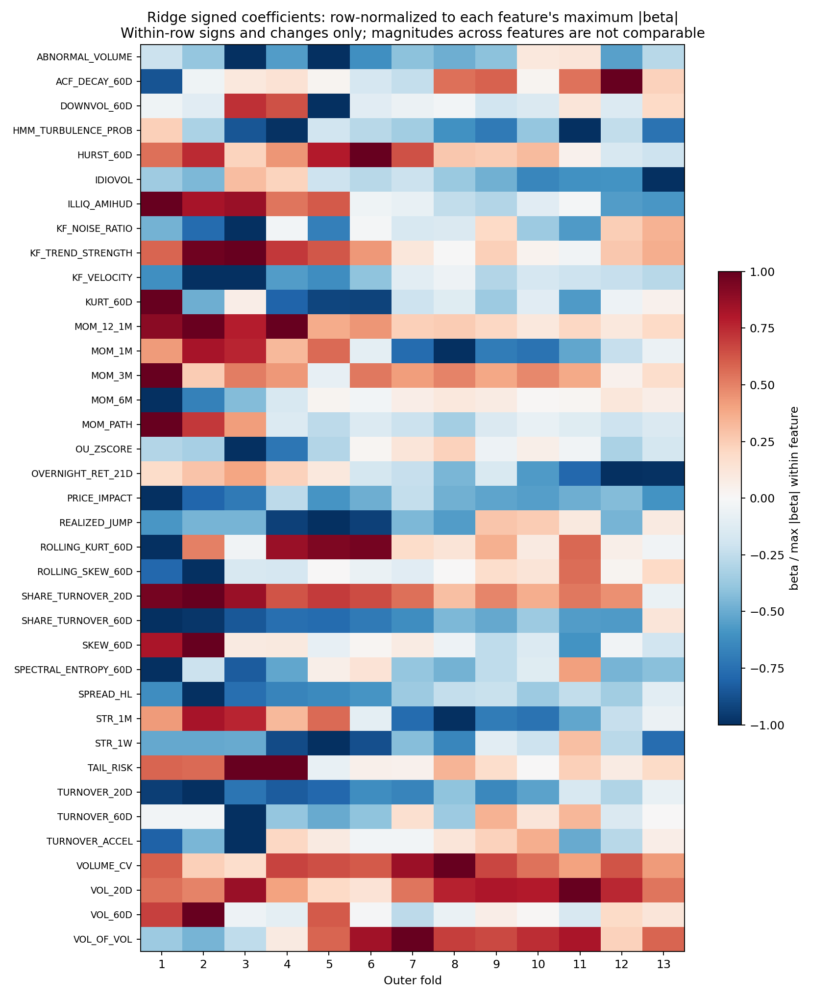
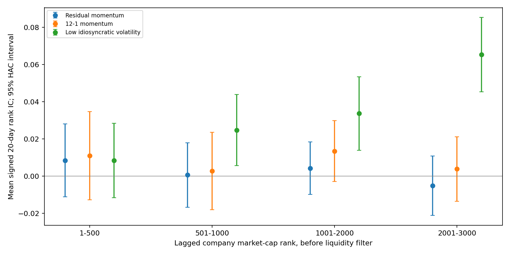

# 长窗口、扩池与模型先验研究：实施与结果

日期：2026-10-24。所有窗口均为**审阅过的历史窗口**，没有新增未触碰的留出集；本文比较属于修订研究协议后的描述性证据。许可数据保存在忽略提交的 `data/wrds/batch4/`，文档只展示聚合统计。

## 1. 判断与已完成的修改

建议有研究必要，收益推断需要收敛到实测结果。已完成三项诊断、CRSP 历史市值扩池、IBES / OptionMetrics 特征、固定因子组合、向先验收缩的 Ridge、训练期剪枝、财务 60/120 日模型，以及一次预先限定参数的较强 LightGBM 测试。共验证 **52 个完整成本账本**，包含全部不利结果。新增模型和数据代理均未替换正式研究基准。

- **P1-A：必要且已完成。** 上一阶段已有 2013-02-04–2025-12-31 的 3248 日、13 折、八模型共同 OOF；其 Ridge Sharpe 标准误从近期窗口约 0.50 降至约 0.24，不能将它解释成收益显著。
- **P1-B：值得实证，不是 IR 自动乘二。** 已扩至历史公司市值前 2000 并做前 500 控制、3000 名以内分层诊断和三因子先验 Ridge。证券数不等于独立赌注数，流动性、行业相关、风险与每笔最低佣金都会影响结果。本文给出修复退市结算后的完整结果。
- **P1-C：值得接入，但尚未通过数据准入。** 已实际下载并治理九个代理特征；原生公告日期并不能证明供应商历史版本未被改写，月度快照的可得日期仍含假设。27 项因子 × 持有期检验没有一项 BH q < 0.05。
- **模型先验：改善了预测，尚未兑现为相对简单基准的净收益优势。** 本次先验 Ridge 的 20 日原始 IC 高于零中心 Ridge，但对应净收益仍未超过同口径固定因子组合；60/120 日财务模型与 ICIR 组合也没有解决问题。

仅凭“37 维、约八万个独立观测”的粗略估算，不能证明维度无法学习；横截面和时间相关都会改变有效样本量。深度 3 的树本身已是非线性模型。每 5 日取一个完整截面减少冗余，**仍保留 20 日标签重叠**，因此本研究仍严格 purge 标签结束日并采用 HAC。

## 2. 先诊断旧模型，避免按 OOS 结果删特征

旧模型诊断复用上一阶段固定分数；原始 IC 按相同股票和有标签的日期配对，3228 个可评估日期，统一 20 日 CRSP 总收益标签。配对 RESID_MOM 的 IC 为 **0.008486**、HAC t = 0.86，本身也不显著。日度 ICIR 定义为 IC 均值 / 日度标准差；资产文件另有朴素 √252 年化值，重叠标签下不能据此推断显著性。

| 标签 | 特征块 | 模型 | 原始 IC | 日 ICIR | IC差 HAC t | 与残差动量相关 | 原始 lag1 rankρ | EMA5 lag1 rankρ |
| --- | --- | --- | --- | --- | --- | --- | --- | --- |
| cross_sectional | price_only | ridge | 0.00233 | 0.018 | -0.61 | 0.229 | 0.9231 | 0.9956 |
| cross_sectional | price_plus_financial | ridge | -0.00049 | -0.003 | -0.78 | 0.178 | 0.9330 | 0.9963 |
| industry_size_vol | price_only | ridge | -0.00086 | -0.005 | -0.94 | 0.155 | 0.9649 | 0.9981 |
| industry_size_vol | price_plus_financial | ridge | -0.00023 | -0.001 | -0.85 | 0.135 | 0.9664 | 0.9981 |
| cross_sectional | price_only | lightgbm | 0.00493 | 0.043 | -0.35 | 0.176 | 0.9074 | 0.9949 |
| cross_sectional | price_plus_financial | lightgbm | 0.00419 | 0.031 | -0.36 | 0.105 | 0.9395 | 0.9969 |
| industry_size_vol | price_only | lightgbm | 0.00339 | 0.020 | -0.50 | 0.135 | 0.9692 | 0.9984 |
| industry_size_vol | price_plus_financial | lightgbm | 0.00460 | 0.026 | -0.36 | 0.126 | 0.9756 | 0.9986 |

八个原始 ML 分数的 IC 点估计都低于残差动量，但配对差异并未形成统计上确定的劣势。相关性仅约 0.10–0.23，不支持“模型只是在复制动量”。EMA5 后 rank 自相关已经约 0.995 或更高；残差动量 EMA5 为 0.99948。高自相关可能仅反映机械平滑，不能替代持有期收益和成本检验，也没有证据支持把 EMA20 直接设为新默认。

按原参数、原训练样本索引和原 BLAS 线程数恢复了四组 Ridge × 13 折的有符号系数，52 次恢复对保存 OOF 的最大预测误差为 **0**。原横截面价量模型 30/37 个特征至少一次发生幅度超过 1e-5 的跨折符号变化。符号翻转可来自共线性和分布变化，不能直接定性为噪声；本轮训练选择没有使用这些 OOS 翻转统计。



上图每行除以该特征最大绝对系数，仅供观察同一特征的符号及变化；特征间幅度不可比较。[实际系数量纲图](assets/research_extensions_20261024/ridge_coefficients_actual.png)与[有符号系数](assets/research_extensions_20261024/ridge_coefficients_by_fold.csv)一并保留。

## 3. 新模型协议与简单基准

新比较为了共同容纳 120 日标签，统一从 **2013-06-27** 至 **2025-12-31**，3148 日、13 折，每个模型 **1,584,035** 个相同预测键。起点晚于上一阶段，特征字典、标准化和训练抽样亦有变化，因此不能把差异归因为仅拉长回放窗口。最后一段没有成熟未来标签时仍保留预测用于回放，只从 IC 中排除。

固定价量先验为 RESID_MOM + MOM_12_1M − IDIOVOL 三因子，财务增强版再加入 GROSS_PROFITABILITY − ACCRUALS，共五因子。每个因子先做当日横截面 rank 映射到 [-1,1]，再等权；缺失置 0。它们是本次固定的经济方向假设，**没有伪称为独立预登记后显著筛出的赢家**。

先验 Ridge 最小化 `mean((y − intercept − Xβ)²) + λ||β − β₀||²`。固定先验因子系数为 ±1/k，其余为 0，截距不惩罚；实现中 sklearn 的惩罚尺度为 nλ。零中心对照使用相同特征、样本、内层选择和 λ ∈ {0.01,1,100}。每折只从成熟训练标签计算方向对齐的 HAC t，非先验特征须 t > 1.5；固定先验不按 OOS 显著性移除。

重复项仅在训练期 |相关| ≥ 0.995 时删除；短周期候选在 1 日强、20 日弱时不进入该 20 日模型。价量 Ridge 最终每折约 5–8 个特征，财务增强约 7–11 个。执行入场过滤需要独立成本试验，本次未把被删短因子直接加到执行层。

LightGBM 保留去重后的完整价量 / 财务字典以允许交互，最高 1000 棵、lr 0.03、Huber、31 叶、深度 5、min_leaf 200、L2 20、固定 seed 17。每 5 个训练交易日取整个截面，内层 126 日验证、60 轮 early stopping，外层严格按内层迭代数重训；部分折只选 1 棵，最高价量 775 / 财务 577 棵，不强行在验证退化后训练到 300 棵。[LightGBM 参数文档](https://lightgbm.readthedocs.io/en/latest/Parameters.html)

| 特征块 | 模型 | 标签日数 | 原始 20/60/120 日 IC |
| --- | --- | --- | --- |
| price_only | ridge_zero | 20 | 0.00310 |
| price_only | ridge_prior | 20 | 0.01071 |
| price_plus_financial | ridge_zero | 20 | 0.00589 |
| financial_only | ridge_prior | 60 | -0.00652 |
| price_plus_financial | ridge_prior | 20 | 0.01349 |
| financial_only | ridge_prior | 120 | -0.01283 |
| price_only | lightgbm | 20 | 0.00742 |
| price_plus_financial | lightgbm | 20 | 0.00343 |

相同新协议预测键下，固定基准的 20 日原始 IC 如下。它们与上一节旧模型诊断的时期、缺失处理有区别，跨表差值不能视为单一改动的因果效果。

| 固定基准 | 20 日 IC | HAC t |
| --- | --- | --- |
| residual_momentum | 0.00709 | 0.71 |
| equal_weight_price_only | 0.01245 | 1.04 |
| equal_weight_price_plus_financial | 0.01649 | 1.47 |

两个先验 Ridge 的原始 IC 也低于各自固定等权基准的点估计；与零中心相比改善，不等于 ML 已创造增量。固定基准自身的 HAC t 同样不足以支持显著性结论。

财务 60/120 日模型独立训练，分别按 60/120 日调仓；跨持有期组合仅以当折内层验证的正 HAC ICIR 加权。全部非正时输出缺失分数以清空 EMA 状态、在调仓时退出持仓，避免零分数在 EMA 后残留旧排序；该分支已单测，本次 3148 日没有触发，不影响已保存回放。长标签不仅是把 20 日模型多持有几天。本次财务长标签 IC 为负，不能接受“短期不显著必然是持有期错配”的解释。

## 4. 同口径成本回放

共同执行参数：$1M，目标 gross 1，单股 1.5%、发行人 3% 上限，EMA10，进入前 / 后 20%、退出 30% 缓冲，目标权重 20% 容忍带，整股成交；20 日模型和固定基准均每 20 交易日调仓。成本包括每股佣金及每单最低 $1、5 bps 单边滑点、参与率冲击、监管费，以及空头年化 50 bps 借券。2× 同时重跑所有交易与借券成本，非简单从 CAGR 减常数。参数用于研究，不能当成已核实的当前券商报价。

| 组合 | 毛 CAGR 1× | 净 CAGR 1× | 净 CAGR 2× | 净 Sharpe 1× | 最大回撤 1× | 日均单边换手 1× | 实际平均 gross 1× |
| --- | --- | --- | --- | --- | --- | --- | --- |
| equal_weight_price_only | 0.46% | -0.07% | -0.57% | 0.030 | -23.24% | 0.67% | 1.027 |
| equal_weight_price_plus_financial | 1.04% | 0.54% | 0.06% | 0.110 | -18.41% | 0.58% | 1.028 |
| financial_only_ridge_prior_h120 | -0.96% | -1.34% | -1.73% | -0.236 | -18.66% | 0.31% | 1.049 |
| financial_only_ridge_prior_h60 | -0.03% | -0.45% | -0.86% | -0.059 | -16.53% | 0.38% | 1.038 |
| price_only_lightgbm_h20 | 0.03% | -0.81% | -1.70% | -0.153 | -22.24% | 1.46% | 1.020 |
| price_only_ridge_prior_h20 | 0.11% | -0.46% | -1.01% | -0.020 | -25.50% | 0.74% | 1.027 |
| price_only_ridge_zero_h20 | -0.85% | -1.51% | -2.16% | -0.168 | -31.51% | 0.95% | 1.027 |
| price_plus_financial_lightgbm_h20 | -0.21% | -0.95% | -1.70% | -0.158 | -20.78% | 1.20% | 1.022 |
| price_plus_financial_ridge_prior_h20 | 0.35% | -0.18% | -0.72% | 0.013 | -22.84% | 0.66% | 1.028 |
| price_plus_financial_ridge_zero_h20 | 0.04% | -0.55% | -1.17% | -0.038 | -23.14% | 0.81% | 1.025 |
| residual_momentum | 1.01% | 0.47% | -0.08% | 0.107 | -14.62% | 0.65% | 1.025 |
| training_icir_ensemble | -1.09% | -1.60% | -2.13% | -0.194 | -27.37% | 0.58% | 1.036 |

最大回撤列为负数。目标 gross 上限约束不等于连续实际持仓上限：调仓间漂移、整股和容忍带会改变 gross；表中列出实际平均值，完整文件另有最大 gross、净敞口和波动率。本文未启用上一阶段的风险中性优化器，也未向上放大到 10% 波动率，避免同时改动信号、风险目标与执行协议。对照结论只适用于本协议。

以下按同日净收益做循环 60 日块 bootstrap（1500 次，seed 2718），展示净 Sharpe 差的 95% 区间。它条件于已实现策略路径，未重新执行完整自适应研究过程，未校正整段历史反复查看和众多模型比较；不等于新留出集的显著性认证。

| 候选 | 配对基准 | Δ净 Sharpe | 95% 块区间 |
| --- | --- | --- | --- |
| price_only_ridge_zero_h20 | equal_weight_price_only | -0.198 | [-0.350, -0.044] |
| price_only_ridge_prior_h20 | equal_weight_price_only | -0.050 | [-0.144, +0.048] |
| price_only_lightgbm_h20 | equal_weight_price_only | -0.182 | [-0.590, +0.247] |
| price_only_ridge_prior_h20 | price_only_ridge_zero_h20 | +0.148 | [+0.036, +0.269] |
| price_plus_financial_ridge_zero_h20 | equal_weight_price_plus_financial | -0.149 | [-0.363, +0.059] |
| price_plus_financial_ridge_prior_h20 | equal_weight_price_plus_financial | -0.097 | [-0.211, +0.023] |
| price_plus_financial_lightgbm_h20 | equal_weight_price_plus_financial | -0.269 | [-0.718, +0.196] |
| price_plus_financial_ridge_prior_h20 | price_plus_financial_ridge_zero_h20 | +0.052 | [-0.121, +0.244] |
| training_icir_ensemble | equal_weight_price_plus_financial | -0.304 | [-0.706, +0.027] |
| top2000_residual_momentum | top500_residual_momentum | -0.027 | [-0.258, +0.226] |
| top2000_equal_weight_price_only | top500_equal_weight_price_only | -0.023 | [-0.253, +0.240] |
| top2000_ridge_prior | top2000_equal_weight_price_only | -0.064 | [-0.238, +0.106] |

这次较强 LightGBM 没有超过固定因子组合，足以暂停该配置的继续调参；不能由一次实验推广为“该股票池所有非线性都无增量”。先验收缩优于零中心的点估计，也不足以支持替换等权基准。

## 5. 扩池与市值分层

原始 common 股份历史共 23,709,962 行、12,139 个历史 PERMNO，覆盖 2008–2025；2008/09 用作预热。按历史公司总市值排名，先聚合所有普通股类别，再按上一日 ADV 选择一个代表类别。采用上一交易日价格 ≥ $5、完整连续 20 日历史 ADV ≥ $2M、上市至少 60 个日历日、美国注册普通股以及 NYSE / AMEX / Nasdaq；先排名再过滤流动性，不用较小股票补足 2000 个名额。新协议回放窗口内有效公司数中位数 **1934**，最少 1840，最多 1989。

这里的前 500 是按同一 CRSP 规则构造的控制组，**并非 S&P 500 指数成分**；也未声称复制 Russell 指数。不同市值组共用扩池前 2000 的市场 / 大小代理，残差动量用过去 504 日回归、每 21 日更新系数，过去 231 日残差和再滞后 21 日；这与旧缓存特征的定义和预热不同，只能在本次扩池控制内比较。



图中 IDIOVOL 已按负方向对齐；诊断期为 2013-02-04–2025-12-31，点为日度横截面 IC 均值，线段为未对 12 项比较作多重调整的 HAC 95% 区间。分层结果支持继续研究低特质波动在较小市值组的差异，不能把它直接视作去除风险与真实借券成本后的 alpha。

| 组合 | 毛 CAGR 1× | 净 CAGR 1× | 净 CAGR 2× | 净 Sharpe 1× | 最大回撤 1× | 日均单边换手 1× | 实际平均 gross 1× |
| --- | --- | --- | --- | --- | --- | --- | --- |
| top2000_equal_weight_price_only | 0.85% | -0.10% | -1.08% | 0.027 | -27.95% | 0.76% | 1.032 |
| top2000_residual_momentum | 0.88% | -0.05% | -1.02% | 0.023 | -17.78% | 0.72% | 1.031 |
| top500_equal_weight_price_only | 0.69% | 0.10% | -0.49% | 0.051 | -24.20% | 0.78% | 1.031 |
| top500_residual_momentum | 0.68% | 0.11% | -0.46% | 0.050 | -21.99% | 0.73% | 1.032 |

扩池三因子先验 Ridge 使用相同固定先验、相同 13 折日期、每五日完整截面和相同 λ 内层选择，只估计三维系数，没有再做第二套 LightGBM 网格。

| 组合 | 毛 CAGR 1× | 净 CAGR 1× | 净 CAGR 2× | 净 Sharpe 1× | 最大回撤 1× | 日均单边换手 1× | 实际平均 gross 1× |
| --- | --- | --- | --- | --- | --- | --- | --- |
| top2000_ridge_prior | 0.32% | -0.62% | -1.59% | -0.036 | -34.22% | 0.73% | 1.035 |

| 扩池组合 | 每单位交易成本 bps | 年交易拖累 bps | 年借券拖累 bps | 成交金额中位数 | 最低佣金订单占比 | 实际参与率 p95 |
| --- | --- | --- | --- | --- | --- | --- |
| top500_residual_momentum | 8.32 | 30.8 | 25.6 | $3,875 | 94.96% | 0.01% |
| top500_equal_weight_price_only | 8.22 | 32.3 | 25.6 | $3,985 | 94.46% | 0.01% |
| top2000_residual_momentum | 18.42 | 66.7 | 25.7 | $941 | 99.35% | 0.03% |
| top2000_equal_weight_price_only | 18.07 | 69.0 | 25.5 | $952 | 99.21% | 0.03% |
| top2000_ridge_prior | 18.61 | 69.0 | 25.6 | $903 | 99.28% | 0.03% |

参与率以成交股数 / 历史 ADV 股数计；最低佣金比例是订单数比例，不是总成本比例。$1M 分散到更多名字会缩小订单，并提高单位佣金成本，因此低参与率本身不能保证扩池提升净 IR。年化成本拖累基于实际每天 NAV 的费用比例，不能与 CAGR 直接线性相减。

具体到三因子等权控制，毛 CAGR 从 0.69% 上升到 0.85%，净 CAGR 却从 0.10% 降到 -0.10%；单位交易成本从 8.22 升至 18.07 bps，成交金额中位数从 $3,985 降至 $952。这支持把佣金方案与账户规模纳入扩池研究，而非把低参与率等同于低总成本；本轮没有按已见收益另调佣金参数。

**结算修复及无效结果披露：** 首版扩池拉取把 `securitytype=EQTY AND securitysubtype=COM` 用于所有行，遗漏了退市时被标成 `N/A / UNK` 的结算观察，造成持仓滞留。现已从同一 CIZ 表补取 9,315 条 `dlydelflg=Y` 记录，并入原历史普通股 PERMNO；采用原生内嵌退市收益、不再次叠加 dlret。缺失结算收益按完全损失的次数为 259。错误版本整目录保存在 `broad_research_20261024_quarantined_missing_terminal` 并标记不准入，本文仅使用补全后重建的特征、标签、训练和回放。

另将扩池后价格与原 S&P 价格交叉对账：2,903,815 个共享日期 / PERMNO 键中，2,900,853 个共同非空收益完全一致，233 条原 S&P 结算记录也全部匹配，退市标记没有分歧。旧 S&P 研究不受此次扩池查询错误影响。

## 6. IBES / OptionMetrics：实际接入与可得性限制

已核验账户的 SELECT 权限，读取真实表结构并使用带有效起止日的 CRSP–IBES 和 CRSP–OptionMetrics 历史链接；只接受 score ≤ 1 且当时唯一的证券匹配，歧义链接抑制信号。新信息范围先限定为原 S&P 研究的历史 PERMNO 并集，尚未声称已覆盖新增 2000 公司全部名字。[WRDS 历史链接说明](https://wrds-www.wharton.upenn.edu/pages/wrds-research/database-linking-matrix/linking-ibes-with-crsp/)

五个 IBES 代理为修正广度、同财政期 EPS 修正、分歧度、目标价隐含收益、价格缩放 SUE；四个期权代理为 30 日 put25 − call50 skew、call50 − put50 IV、IV − 21 日已实现波动率、期权合约量 / 百万股票成交股数。期权表来自 EOD 常期限 / delta 曲面及日成交量，不假设每份期权合约都对应 100 股。[OptionMetrics 产品口径](https://optionmetrics.com/data-products/)

call/put IV 差是同 delta / 同期限代理，不是严格同执行价的 Bali–Hovakimian 复刻；论文提供机制参考，不能替代本项目验证。[Bali 与 Hovakimian，2009](https://pubsonline.informs.org/doi/abs/10.1287/mnsc.1090.1063?journalCode=mnsc)

| 特征 | 可评估覆盖率 | 20 日原始 IC | HAC t | 全 27 项 BH q |
| --- | --- | --- | --- | --- |
| IBES_REVISION_BREADTH | 99.27% | 0.00949 | 1.60 | 0.642 |
| IBES_DISPERSION | 99.27% | -0.01222 | -1.30 | 0.642 |
| IBES_EPS_REVISION | 90.98% | 0.00638 | 1.04 | 0.642 |
| IBES_TARGET_IMPLIED_RETURN | 98.94% | 0.01077 | 0.97 | 0.642 |
| IBES_SUE_PRICE_SCALED | 98.16% | 0.01305 | 2.77 | 0.151 |
| OPTION_PUT25_SKEW | 96.92% | 0.00223 | 0.58 | 0.801 |
| OPTION_CP50_IV_DIFF | 96.92% | 0.00276 | 1.37 | 0.642 |
| OPTION_IV_MINUS_RV | 96.91% | -0.00467 | -0.76 | 0.668 |
| OPTION_CONTRACTS_PER_MILLION_SHARES | 97.45% | 0.00149 | 0.24 | 0.828 |

IC 保留原始方向；回放前固定的方向为：修正、目标价和 SUE 为正，分歧与 put skew 为负，call−put IV 与 IV−RV 为正；无方向期权量采用正注意力代理，明确属于探索性方向假设。这些方向在查看因子 IC 后、运行回放前写入计划，不能伪称事前注册。九个都回放，没有删除失败者或在收益出现后翻转符号。

| 组合 | 毛 CAGR 1× | 净 CAGR 1× | 净 CAGR 2× | 净 Sharpe 1× | 最大回撤 1× | 日均单边换手 1× | 实际平均 gross 1× |
| --- | --- | --- | --- | --- | --- | --- | --- |
| IBES_DISPERSION | -0.65% | -1.12% | -1.60% | -0.139 | -28.66% | 0.50% | 1.030 |
| IBES_EPS_REVISION | 1.02% | 0.07% | -0.92% | 0.040 | -21.99% | 1.78% | 1.016 |
| IBES_REVISION_BREADTH | 1.03% | 0.11% | -0.78% | 0.047 | -20.97% | 1.70% | 1.018 |
| IBES_SUE_PRICE_SCALED | 1.09% | 0.46% | -0.22% | 0.153 | -7.87% | 0.93% | 1.024 |
| IBES_TARGET_IMPLIED_RETURN | 0.36% | -0.26% | -0.89% | -0.001 | -25.12% | 0.87% | 1.023 |
| OPTION_CONTRACTS_PER_MILLION_SHARES | 0.97% | 0.59% | 0.22% | 0.164 | -9.11% | 0.25% | 1.028 |
| OPTION_CP50_IV_DIFF | 0.52% | -0.56% | -1.66% | -0.154 | -12.55% | 2.14% | 1.019 |
| OPTION_IV_MINUS_RV | -0.20% | -1.41% | -2.65% | -0.284 | -22.17% | 2.55% | 1.018 |
| OPTION_PUT25_SKEW | 0.01% | -0.67% | -1.34% | -0.120 | -15.80% | 1.05% | 1.025 |

SUE 使用未复权原始季度实际 EPS、公告前已可得的同财政期月度共识，差值除公告前股价，再除过去八次事件差值的标准差（至少四次），它是**月度共识、价格缩放的 SUE 代理**。修正只比较相同财政期，不把 FY1 换年跳跃当成盈利修正。股价、EPS 与目标价口径需要一致，拆股窗口排除 35 日，以减少供应商生效日期差异；这仍不是历史版本认证。[WRDS：IBES 未复权数据说明](https://wrds-www.wharton.upenn.edu/documents/5/A_Note_on_IBES_Unadjusted_Data_pdf.pdf)

保守可得时间统一为快照日、公告日与供应商激活日之后的首个交易日；季度共识严格早于公告，滚动标准差只读此前事件。IBES 月度快照的实际发布时间未逐条核实，这个次日规则仍是研究假设。月度特征最多陈旧 45 日、SUE 126 日、期权 7 日；显式缺失会清空旧信号，链接到期立即失效，不用旧值跨链接续接。原生 available_date、严格因果计算和供应商 PIT vintage 是三个不同问题，`source_point_in_time_proven=false`。

**原始数据角色更正：** 最初把 `nact_epsus` 错认成未复权原始实际盈利；WRDS 原生表说明显示 `n` 表示 Normalized。错误版本已隔离，原反向 SUE 推断撤回。最终实际值只来自 `actu_epsus`，目标价来自 `ptgsumu`，并有描述字段守卫拒绝 Normalized 来源；`nactu_epsus` 同样不能因含 unadjusted 就被误认为原始口径。修复清单、原始文件、失败与隔离产物均保留，本文不采用其收益或 IC。

## 7. 准入结论、验证与复现

当前保留固定因子基准、低换手工具、长 OOS 诊断与新数据研究接口；新增学习模型和替代数据策略均为研究候选。SUE 有正向点估计，但多重检验、历史版本、真实借券与独立未来窗口仍待验证。没有依据把新增数据直接并入正式模型，或承诺净收益达到某个目标。

所有 52 个完整账本均检查整股、零成交零费用、参与率 ≤ 10%、订单费用与日账本及成本来源加总、NAV 费用恒等式；八模型预测键一致，内外训练标签严格早于验证起点。上一阶段冻结来源 147 项哈希保持一致。完整测试：**520 passed, 48 warnings in 116.04s (0:01:56)**。验证不会证明风险模型正确、供应商无修订或真实卖空一定可执行。

仍有边界：研究使用总收益美元持仓账本，没有另建逐股现金 / 公司行动的第二套独立对账；固定借券利率没有真实可借数量和个股费率，分红及退出处理依赖 CIZ；实际 gross 可能超出目标，不能据此宣称严格中性。训练期 t 筛选也有选择误差，未来应以已冻结协议的增量窗口检验，而非继续查看同段历史后宣布有效。

复现入口（从项目根目录运行；已完成输出目录禁止覆盖，需指定新目录或调整独立研究输出）：

```powershell
python scripts/diagnose_wrds_ml.py --help
python scripts/acquire_wrds_extensions.py --help
python scripts/repair_wrds_broad_terminal.py
python scripts/build_wrds_broad_research.py --help
python scripts/acquire_wrds_alternative.py --help
python scripts/repair_wrds_ibes_basis.py
python scripts/build_wrds_alternative_features.py --help
python scripts/research_wrds_priors.py --help
python scripts/replay_wrds_extensions.py --help
python scripts/research_wrds_broad_prior.py --help
python scripts/replay_wrds_alternative.py
python scripts/report_wrds_extensions.py
```

[统一研究配置](../config/wrds_research_extensions.yaml)、[全部绩效与成本](assets/research_extensions_20261024/all_performance.csv)、[配对区间](assets/research_extensions_20261024/paired_bootstrap.csv)、[验证记录](assets/research_extensions_20261024/verification.json)、[证据清单](assets/research_extensions_20261024/evidence_manifest.json)。阶段输入与输出哈希、训练快照和最终新增代码快照保存在各阶段元数据中；最终代码快照不冒充每个早期阶段完整环境镜像。
