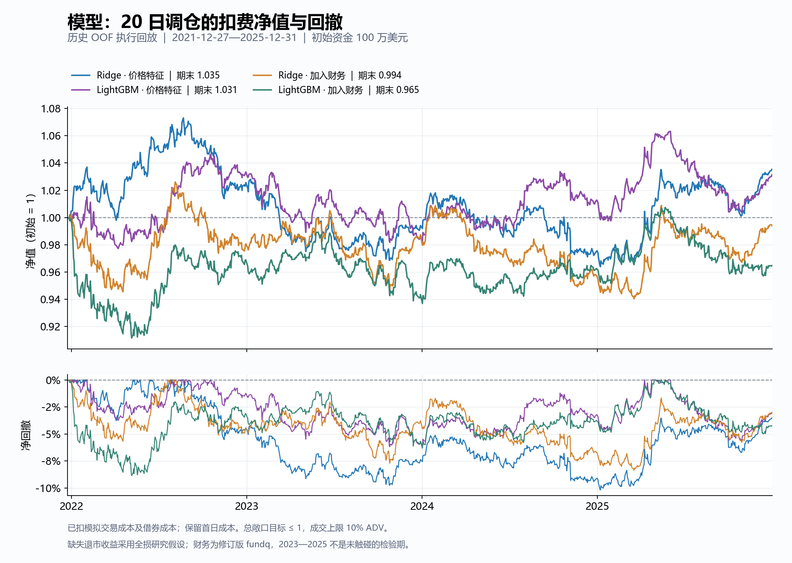
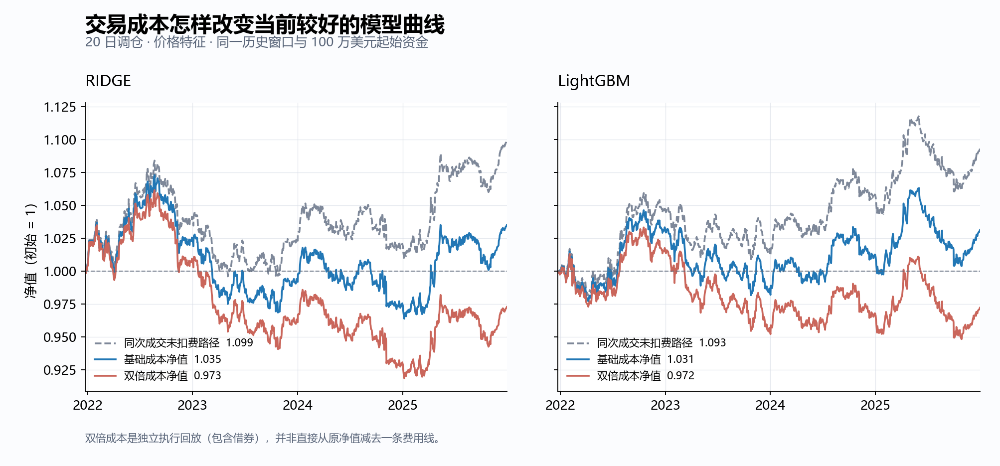
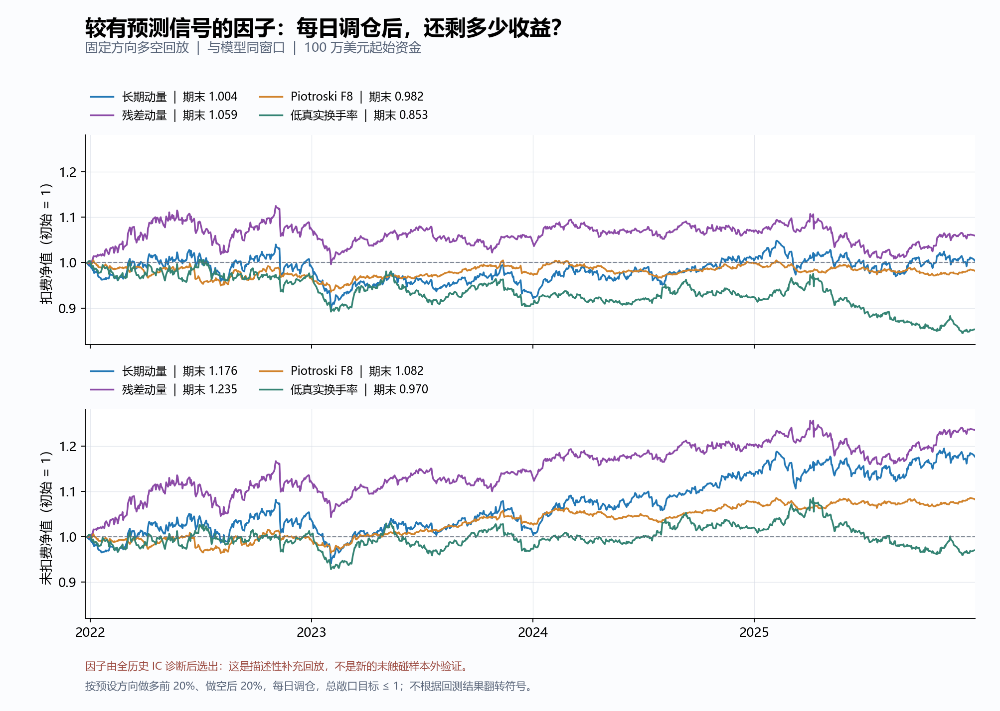

# EntroPy 阶段性研究记录（2026-10-23）

> 报告性质：数据、实现及历史研究结果的阶段快照。研究源码基线为 `83bc1b5`；模型历史 OOF 和正式回放源版本为 `35ddc5f`。本报告新增的文档提交不改变这些历史产物的源码记录。
>
> 数据截止：**2025-12-31**。因子统计窗口：**2010–2025**。模型和补充因子回放窗口：**2021-12-27—2025-12-31**，共 **1,008** 个交易日。本报告没有使用 2026 年市场数据，也没有在编写时重训或重新选参。

## 1. 阶段结论

项目已完成从当前成分股代理数据到 CRSP 历史成分、稳定证券标识和直接总收益口径的主要迁移，并修复了会影响研究结论的若干计算与准入问题。当前工程验收和数据可追溯性明显改善，**稳健扣费盈利的证据仍不足**。

| 层面 | 当前状态 | 可支持的判断 |
| --- | --- | --- |
| 数据 | 857 个历史 PERMNO；包含退市及历史成分区间 | 所覆盖历史 S&P 500 股票池的成员与主键准入已通过 |
| 基本面 | 覆盖率恢复，版本与可得日期显式标记；主要来自修订版 fundq | 可做带限制的历史研究，严格 PIT 财务准入仍不满足 |
| 因子 | 原有 42 个因子完整迁移，新增 2 个真实股数换手率因子 | 若干短期 Rank IC 有统计支持；20 日稳健性较弱 |
| 模型 | Ridge、LightGBM 完成同样本嵌套时间验证及成本回放 | 未证明 LightGBM 或财务信息带来稳定增量 |
| 执行 | 账本、成本加总、整股、可交易性及参与率等检查通过 | 当前固定资金假设下回放可审计；独立仓位/现金核对待补齐 |
| 部署 | `production_admitted=false` | 当前不作为已达到生产部署要求的策略 |

当前较有信号的是长期动量、残差动量、F8 和部分流动性指标，但统计信号、扣费收益和独立验证是三种不同证据。10 月 23 日补充回放中，残差动量在四个选中因子里相对最好，仍有较明显回撤与成本损耗。MLP 本阶段只保留此前接口/短样本 smoke 证据，没有新的完整可比业绩结论。

## 2. 数据资产与口径

### 2.1 数据权限与研究范围

此前账户实测权限记录为 `crsp, crsp_a_indexes, crsp_a_ccm, comp, ibes, optionm, djones, cboe, audit, tfn, ciq`；当时没有 TAQ 和 `comp_na`。这是先前的账户实测记录，本报告未重新查询订阅权限。当前主实验使用 CRSP、Compustat/历史 Snapshot 和 CCM，IBES、期权等库尚未转化为本批经过验证的模型特征。

股票池定义为研究窗口内的历史 S&P 500 成分，结论的适用范围也限定于该样本。价格保留 2009 年历史作为滚动指标预热；不把旧流程延伸至 2026-07-21 的结果与当前 CRSP 截止窗口拼接。以后扩展 2026 年数据需要独立的数据一致性和结算核验。

### 2.2 当前文件与规模

所有下表文件位于本地 `data/wrds/`。最初下载与后续修复版本分目录保存。

| 资产 | 行数 | 列数 | 说明 |
| --- | --- | --- | --- |
| 历史成分 | 874 | 4 | 857 个 PERMNO，874 段区间 |
| 名称史 | 3,639 | 6 | 仅用于展示/历史映射，不作为主键 |
| CCM 链接 | 1,004 | 7 | 848 PERMNO ↔ 856 GVKEY，带有效期 |
| 原始 CRSP CIZ 日线 | 2,903,815 | 17 | 857 个 PERMNO；含 233 条终止记录 |
| 最初下载的处理后财务 | 29,436 | 240 | 保留作历史原始输入，不作为本阶段当前财务版本 |
| 当前修复版财务事件 | 48,958 | 720 | 839 个已链接 GVKEY；版本/失效事件及派生字段 |
| P0 价格适配 | 2,903,815 | 39 | 39 列，直接总收益、PERMCO、公司市值等 |
| 公司普通股类补充 | 2,959,206 | 8 | 879 个证券，较主样本增加 22 个非指数内股类 |
| 公司级市值 | 2,898,351 | 6 | CRSP 可观察普通股类聚合口径 |
| 行业历史 | 4,453 | 5 | 857 个证券，4,453 段 SIC/NAICS 生效区间 |
| 完整因子面板 | 2,903,815 | 53 | 44 个因子；2010–2025 合格研究行 2,021,564 |

当前修复版财务表为 **48,958 行 × 720 列**，覆盖 **839** 个已链接 GVKEY；这些行是版本/有效性事件，不等同于独立的公司季度数。其财报期末覆盖至 2025-11-30、有效可得事件至 2025-12-22，受 2025-12-31 统一截止约束。

### 2.3 身份、成分、收益与退市

- 使用 `(date, permno)` 唯一主键；`ticker=PERMNO:<id>` 只是兼容旧接口的稳定别名。交易所 ticker 仅作展示与历史映射。名称史中有 ticker 复用和同时冲突，不能用今天的 ticker 回连历史证券。
- 历史成员区间、交易资格及其决策滞后分别处理。成员/身份准入与财务版本准入已拆分；允许修订版财务研究的参数不能跳过历史成员、唯一键或 PERMNO 检查。
- 数据源为 CRSP **CIZ `dsf_v2`**；直接总收益优先于复权价格端点比值，退市收益已嵌入，禁止再次叠加 `dlret`。
- 233 条终止记录中，231 条有观测终止收益；SIVB/SBNY 对应的 **2 条**终止收益缺失（PERMNO 11786、90090，2023-03-13）。默认处理为报错，研究实验显式分别采用全损和零收益假设。独立“第 2 日终止/20 日持有”对账覆盖 **231 条可构造路径，其中 229 条使用观测收益、2 条使用显式假设**；另 2 条受完整窗口或起始报价条件限制未进入该项对账，不能将其记为 233 条逐条验证。
- 多日标签计入一次终止损益，之后至原定标签结束日持有零收益现金。普通缺报价仍是未知值，标签跨越数据截止也保持缺失；未来标签是否可得不能决定当日是否生成预测。

### 2.4 严格 PIT 边界与财务修复

`fundq + rdq` 解决披露时间对齐的一部分问题，修订版数值仍可能包含后来修正。当前最终财务事件表的来源与严格标记为：

| 项目 | 当前数量/状态 |
| --- | --- |
| 修订版 fundq 来源行 | 46,274 |
| Snapshot 来源事件行 | 2,682 |
| 显式失效事件 | 2 |
| 行级 `is_point_in_time=true` | **5** |
| 行级非严格 PIT | 48,953 |
| 至少存在混合 vintage 的事件行 | 4,709 |
| 最终事件中可得日期缺失、按 90 日滞后估计 | 28 |
| 可得日期早于期末、被约束修正的最终事件 | 38 |

这些口径与最初 29,436 行下载表的 PIT 标签不同。重建已补足完整区间数据、展开有效期/派生依赖，并采用更严格的行级判定。**Snapshot 来源行数不能直接当作严格 PIT 派生样本数**；行级为真要求所有已输出的有限派生值具有合格依赖，具体特征仍以字段级 provenance 为准。历史 Snapshot 样本只延伸到 2015-03-31，覆盖本次关联样本中的 54 个 GVKEY，无法覆盖整个研究窗口。

本阶段已保留单季利润表项，仅对年内累计现金流项差分；TTM 要求连续完整四季，派生值使用当时有效的可得版本。披露日期按下一 XNYS 交易日处理，并落实信号决策滞后；复用 P0 已滞后的财务特征时不重复移位。货币未知或非 USD 的财务比率会被抑制。

公司财务分子对应历史 PERMCO 的**CRSP 可观察普通股类总市值**，包括指数外同公司普通股类；证券级市值另行保留。补充了 22 个主样本外股类，识别到 57,267 个多股类公司日期。CCM 归属要求当时有效且无冲突。非上市/私有股类没有可独立观察的 CRSP 价格，当前口径不为其虚构市值。P0 仍有 3,037 个价格行缺少公司市值，相应比率依赖可得性处理。

历史行业已接入 4,453 段有效期记录，合格研究行的滞后行业覆盖率为 100%；当前使用 SIC 两位行业。行业有效期历史没有 as-reported 发布版本保证，因此 `classification_is_point_in_time=false`；严格财务标记也仍为 false。

## 3. 已完成的正确性与工程修复

| 范围 | 已完成处理 | 验证与解释边界 |
| --- | --- | --- |
| 优化目标量纲 | 排名信号按配置的年化横截面收益假设转为日预期收益，与日协方差匹配 | 这是优化器先验映射；本批 ML 输出仍是无量纲分数 |
| 优化失败 | 抛出 `PortfolioOptimizationError`，上层显式决定并记录降级 | 不再静默替换组合 |
| 风险模型 | 移除候选 alpha 自指涉，使用市场、滞后 log 市值分组的 SMB、行业暴露及特异风险；校验 Euler 加总 | 因子数随行业类别变化；属于紧凑结构模型，当前正式 ML 回放未采用该优化器 |
| 增量统计 | 带截距 OLS 的截距及完整 Newey–West sandwich 标准误；appraisal ratio 与 HAC t 分开 | 不再用带截距回归的残差均值代替 alpha |
| 容量/交易 | ADV 过滤不可交易和非正量，最少观测数与最小 ADV；区分请求/成交参与率，统一 p95 样本口径，缩放后重施加限制 | 容量估计仍需资金档位完整回放验证 |
| 缺失收益 | 共享收益与标签采用直接总收益、共享日历、显式缺失语义 | 取消默认 `pct_change()` 的价格缺口填充 |
| 隔夜/拆股 | 用总收益与同日原始 `close/open` 分解，明确将分配收益归于隔夜的约定 | 经济收益为零的拆股不会制造隔夜损失 |
| ML 标识符 | 显式预测特征白名单；标识符、来源、PIT 标签隔离；证券重编号回归 | 覆盖线性 ML、LightGBM、MLP 相关路径及有上限的抽样 |
| 抽样并列 | 各信息组共享抽样键，并使用同一预测特征并集打破并列，禁止用编号/元数据排序 | 合成边界已复现并修复；真实 2,021,564 行无共同价量键重复，历史 OOF 不受该修复影响 |
| 状态/统计因子 | Kalman 从首个有效观测初始化且可恢复；时序完整窗口拒绝伪零；OU 不可用拟合保持缺失，方向修正 | 七项因子做真实 CRSP 前缀/未来扰动检查 |
| 价量计算 | 缓存与非缓存的日期对齐、最少观测一致；形成期内回撤；高低价跨日可比单位；市值/资格代理使用滞后信息 | 拆股、乱序输入及缓存一致性回归 |
| 评分与落盘 | 无测量证据时排除 crowding 并重归一权重；缺失 DSR 不给替代分；交易与账本分开持久化 | PRS 的目录级 DSR 假设不代表本批全部搜索的全局 DSR |

风险模型当前为市场/规模/行业结构，不能记录成已经验证了固定“四个标量因子”的商业 Barra 复刻。本批正式比较使用分位数多空组合和发行人上限，不能把其收益归因于风险优化器。 风险模型拟合窗中的 `sector_map` 仍假设静态有效；历史优化实验需要进一步验证按时点供图和行业变更处理。

## 4. 因子库与诊断

### 4.1 范围与覆盖率

因子库共 **44** 个：34 个横截面、8 个时间序列、1 个单证券 regime、1 个 relative-value 因子。HMM 是单证券动荡概率，OU 是单证券均值回复偏离。新增的 `SHARE_TURNOVER_20D/60D` 是成交股数/流通在外股数的真实换手率，原 `TURNOVER_*` 相对成交量代理保留原名与定义。

股票池过滤在横截面排序前进行；收益和窗口使用统一交易日历。方向按预先声明的 `FactorMeta.direction` 固定。下列覆盖率的分母是 2010–2025 合格研究样本，与最初小规模财务下载的旧覆盖率不属于完全相同的版本/分母。

| 基本面因子 | 当前有效覆盖率 |
| --- | --- |
| ASSET_GROWTH | 97.56% |
| GROSS_PROFITABILITY | 98.67% |
| ACCRUALS | 98.48% |
| BOOK_TO_MARKET | 99.72% |
| EARNINGS_YIELD | 99.01% |
| PIOTROSKI_F8 | 83.98% |

### 4.2 统计结果

统一诊断包含 1/5/20/60 日 Rank IC、保留缺失日历的 HAC、年度与行业/规模/历史波动分组、冗余、行业暴露及相对动量/盈利能力的残差信号。44 个原始因子加上六个财务因子的匹配与行业/市值残差分支，共 **224** 个汇总检验。

BH 是对这 224 个检验条目的探索性校正。只有 1 日周期出现 **10 个** `q<0.05` 的条目；这些包含同一因子的不同变体和负向 KF 结果，不能计为 10 个独立盈利因子。5/20/60 日均没有条目达到该阈值。HAC 针对重叠收益考虑滞后，尚不代表因果或未来盈利证据。

下面的 IC 已按预设方向调整；正值表示沿预设方向更有利。

| 因子 | 1 日 IC | 1 日 q | 20 日 IC | 20 日 q |
| --- | --- | --- | --- | --- |
| MOM_12_1M | 0.0148 | 0.0008 | 0.0099 | 0.7022 |
| RESID_MOM_12_1M | 0.0112 | 0.0018 | 0.0088 | 0.6734 |
| PIOTROSKI_F8 | 0.0073 | 0.0005 | 0.0052 | 0.6875 |
| SHARE_TURNOVER_20D | 0.0083 | 0.0404 | 0.0064 | 0.7322 |
| GROSS_PROFITABILITY | 0.0048 | 0.2604 | 0.0113 | 0.4841 |
| IDIOVOL | 0.0080 | 0.0515 | 0.0121 | 0.5142 |
| STR_1W | 0.0067 | 0.1115 | 0.0096 | 0.2916 |
| BOOK_TO_MARKET | -0.0074 | 0.0628 | -0.0141 | 0.4192 |
| ASSET_GROWTH | -0.0040 | 0.0901 | -0.0076 | 0.4841 |
| KF_VELOCITY | -0.0076 | 0.0375 | -0.0114 | 0.2831 |
| KF_TREND_STRENGTH | -0.0067 | 0.1048 | -0.0101 | 0.4192 |
| OVERNIGHT_RET_21D | -0.0019 | 0.6875 | -0.0140 | 0.2604 |
| HMM_TURBULENCE_PROB | 0.0018 | 0.4841 | 0.0052 | 0.3070 |
| OU_ZSCORE | 0.0017 | 0.6354 | 0.0055 | 0.5862 |
| SPECTRAL_ENTROPY_60D | -0.0003 | 0.9443 | -0.0029 | 0.7022 |
| HURST_60D | 0.0006 | 0.8540 | -0.0009 | 0.9443 |

应计利润的行业/规模处理有改善迹象：20 日原始 IC 为 0.00069；在同一可比较子样本上，匹配原始值 IC 为 **0.00347**，联合行业/规模残差为 **0.00925**，HAC t 为 **2.74**，但 q 为 **0.0695**。匹配两分支的有标签样本均为 **1,707,408** 行。此结果支持另行预登记的研究假设，没有通过本阶段 5% 多重检验门槛。

长期/残差动量、F8 和部分流动性信号在短周期相对突出；HMM、OU、熵及 Hurst 的当前证据较弱。Kalman 速度/趋势、隔夜收益，以及部分价值/资产增长结果沿既定方向偏负。符号或经济机制的新假设需要另行登记与检验。

### 4.3 冗余与稳定性

- `SKEW_60D` 与 `ROLLING_SKEW_60D`、`KURT_60D` 与 `ROLLING_KURT_60D` 的有效共同样本原始日排序几乎相同。
- `MOM_1M` 与 `STR_1M` 原始排序相同、预设方向相反，直接等权混合可能相互抵消。
- `MOM_6M/MOM_PATH` 的原始排序相关约 0.957；`DOWNVOL_60D/TAIL_RISK` 约 −0.967。
- 原始毛盈利能力、长期动量、低特异波动的 20 日 IC 分别在 16 年中有 10、11、11 年为正，年度表现仍不稳定。

这些全历史结果仅用于诊断和形成下一轮假设，没有反向改变本批模型的特征选择、方向或超参数。

## 5. 模型实验设计与版本

| 项目 | 本阶段配置 |
| --- | --- |
| 信息组 | `price_only`：38 个价量/行情派生特征；`price_plus_financial`：加六个财务特征，共 44 个 |
| 特征准入 | 显式白名单；覆盖/方差门槛在首个内层验证前锁定，锁定日为 2021-04-30 |
| 排序与缺失 | 当日合格横截面转为 [-1,1] 排名；缺失特征用固定中点 0；无全样本拟合的插补器 |
| 主任务/稳健性 | 20 日标签为主；5 日标签复用主任务参数，避免再次搜索 |
| 外层验证 | 四折 expanding walk-forward，每折 252 个预测交易日 |
| 内层验证 | 每折 126 日，选参不访问该折外层标签；按真实 `label_end` 清除交叠 |
| 初始训练长度 | 至少 756 日；各次训练最多抽样 200,000 行 |
| 样本公平性 | 两信息组及模型使用一致的预测证券/日期键；相同阶段的上限训练样本键一致 |
| Ridge | `alpha ∈ {10,100}` |
| LightGBM | 两组保守配置：7/15 叶、深度 3/4、最小叶样本 1000、正则 20/40、80 棵树 |
| 随机种子 | LightGBM 固定 17、43、101 三种子平均 |
| 对照 | 固定方向等权、固定长期动量/盈利能力、固定逐日打乱 Ridge 预测的负对照 |
| 预算与记录 | 12 个声明的模型/信息/周期配置；所有内层候选、重拟合和种子记录在 trial registry |

价量信息组也包含 Kalman、HMM、OU 等行情派生信号；它并非只用原始 OHLC。输出是无量纲排序分数，本批按分位数转为组合目标，没有把它直接视为预期收益输入均值方差优化器。

20 日外层边界如下；每信息组每周期共 **506,738** 个预测证券/日期行，未因为未来标签缺失而删掉当日预测。

| 外层折 | 预测开始 | 预测结束 | 训练标签最晚结束 | 内层验证开始 |
| --- | --- | --- | --- | --- |
| 1 | 2021-12-27 | 2022-12-23 | 2021-12-23 | 2021-05-28 |
| 2 | 2022-12-27 | 2023-12-27 | 2022-12-23 | 2022-05-27 |
| 3 | 2023-12-28 | 2024-12-27 | 2023-12-27 | 2023-05-31 |
| 4 | 2024-12-30 | 2025-12-31 | 2024-12-27 | 2024-05-31 |

主全损实验记录 20 日 96 次实际单模型拟合、5 日 32 次；这类次数包含种子与重拟合。12 个配置与实际拟合次数都不是有效独立试验数，报告不据此宣称全局 Deflated Sharpe 已过关。2023–2025 已被审阅，是历史 OOF 复核窗口；未来独立检验需要新的、未用于决策的期间。

## 6. 模型与固定基线回测表现

### 6.1 共同执行假设

- 起始资金 **100 万美元**；多空对称分位数组合，目标总敞口不超过 1、净敞口目标 0。
- 个股目标上限 1.5%，发行人普通股类合计目标 gross 上限 3%，最低有效名称数 100。
- 最大成交参与率 10% ADV；ADV 只使用先前可交易且正成交量记录，最少观测与最小 ADV 门槛生效；整股成交。
- 现行研究默认成本包括每股佣金 0.005 美元、每单最低 1 美元、单边滑点 5 bps、波动/参与率平方根冲击模型、卖出费用及年化 50 bps 借券成本。它们是模拟假设，没有按 TAQ 或真实成交校准；也不是本报告日期的券商费率声明。
- 双倍成本是独立执行回放，包含借券等成本变化及 NAV/成交路径反馈。
- 年化按 252 个交易日，净年化为复利增长率；Sharpe 使用日收益均值/波动年化，本批无风险利率假设为 0。
- 主表采用两条缺失退市收益的 `total_loss` 情景；`zero_return` 用于独立敏感性对照。其余已观测 CIZ 终止收益只计一次。

目标约束不保证非调仓日实际敞口不漂移，也不保证持续的行业/贝塔中性。最后一个持有区间可能因 2025-12-31 截止而缩短，期末没有额外假设全组合清仓。

### 6.2 20 日任务

| 模型 | 信息组 | 基础成本净年化 | 净 Sharpe | 最大净回撤 | 双倍成本净年化 |
| --- | --- | --- | --- | --- | --- |
| ridge | 价量/行情派生 | 0.873% | 0.2177 | 10.17% | -0.680% |
| lightgbm | 价量/行情派生 | 0.777% | 0.2038 | 6.18% | -0.700% |
| ridge | 加入财务 | -0.155% | -0.0091 | 8.36% | -1.628% |
| lightgbm | 加入财务 | -0.892% | -0.1611 | 8.85% | -2.168% |

价格特征 Ridge 的累计净收益为 **3.54%**，LightGBM 为 **3.14%**；加入财务后的两者累计为 **−0.62%**、**−3.52%**。Ridge 在 2023/2024 年分别约 −3.08%/−1.86%，2025 年约 +6.13%；LightGBM 在 2023 年约 −4.50%，2024/2025 年约 +2.60%/+1.86%。收益有明显回吐与阶段依赖。



### 6.3 5 日稳健性任务

| 模型 | 信息组 | 基础成本净年化 | 净 Sharpe | 最大净回撤 | 双倍成本净年化 |
| --- | --- | --- | --- | --- | --- |
| ridge | 价量/行情派生 | 0.003% | 0.0298 | 11.28% | -4.529% |
| lightgbm | 价量/行情派生 | -1.438% | -0.2333 | 11.12% | -5.803% |
| ridge | 加入财务 | -0.428% | -0.0480 | 9.91% | -4.643% |
| lightgbm | 加入财务 | -2.373% | -0.4121 | 12.72% | -6.286% |

在当前执行假设下，缩短持有期没有改善扣费表现。不能把未扣费 IC 的改善直接解释为更高的可交易净收益。

### 6.4 固定基线、增量与敏感性

20 日固定长期动量基线净年化为 **0.087%**、净 Sharpe 为 **0.0540**；毛盈利能力基线为 **−1.889%**、**−0.2939**。逐日打乱 Ridge 的固定负对照在两个周期及成本档位均亏损；等权组合也没有建立稳健扣费优势。

20 日财务信息组的 LightGBM 相对 Ridge，平均 IC 增量约 **0.00056**，配对 95% 区间为 **[-0.01529, 0.01666]**。财务相对价量信息的 IC 增量，Ridge 为 **−0.00284**、LightGBM 为 **−0.00108**，相应区间均跨零。

八个主实验配对净收益增量区间也全部跨零。20 日财务信息组 LightGBM 减 Ridge 的平均日净收益差为 **−0.292 bps**，95% 区间约 **[-1.731, 1.023] bps**。这些是内层选择之后的描述性历史推断，尚未修正项目全部历史探索。

全损与零收益两个情景各完成 36 组正式回放，共 **72 组**；零收益情景的两个周期均使用冻结的主任务参数。对应组合年化净收益的最大绝对变化约 **0.335 个百分点**。两个情景下，所有 Ridge/LightGBM 信息组在双倍成本时均为负收益。两个假设均不是观测终止收益，也不是已证明的真实结算收益上下界。



## 7. 10 月 23 日新增的因子执行回放

此前 IC 较有信号的四个因子被补做为每日调仓多空策略，使用与模型相同的 506,738 个历史合格证券/日期键、同一 1,008 日窗口和执行器。方向固定为元数据声明方向，信号已包含原有滞后，没有根据这次收益再翻转符号。

这些因子是在看过全历史诊断后挑选的，**本节是描述性补充研究，不能作为新的独立样本外验证**。当前只做基础成本、全损情景，没有为这四条新增策略补做双倍成本、零收益情景或完整资金容量曲线。

| 因子（每日调仓） | 未扣费累计 | 累计净收益 | 净年化 | 净 Sharpe | 最大净回撤 |
| --- | --- | --- | --- | --- | --- |
| MOM_12_1M | 17.62% | 0.37% | 0.09% | 0.0554 | 13.79% |
| RESID_MOM_12_1M | 23.53% | 5.95% | 1.46% | 0.2191 | 11.43% |
| PIOTROSKI_F8 | 8.23% | -1.85% | -0.47% | -0.1025 | 6.91% |
| SHARE_TURNOVER_20D | -2.95% | -14.71% | -3.90% | -0.4689 | 16.09% |

“未扣费累计”取自同次执行的 gross 路径，未另行运行完全零成本策略。残差动量累计未扣费约 **23.53%**，扣费后约 **5.95%**；长期动量约 **17.62% → 0.37%**；F8 约 **8.23% → −1.85%**；低真实换手率约 **−2.95% → −14.71%**。

因子缺失分数保持缺失，只对当期可用值排序。正式模型中的固定因子基线则复用学习面板的排序/中点插补。因此，本节日频动量与上节 20 日动量还存在缺失分数处理差别，不能作为只改变调仓频率的严格消融。原 P0 动量还比本批 registry 的 `P[t-21]/P[t-252]-1` 约定多一个决策滞后，旧版本业绩也需单列。



图中上半部分是净值，下半部分是同次成交未扣费路径，纵轴范围一致。起点按原始 100 万美元标准化，保留首日交易成本；没有通过除以首个已扣费 NAV 消除开仓成本。

## 8. 测试、验收与容量证据

最近完整测试记录为 2026-10-21：**仓库已提交测试 449 项**，本批新增回归 31 项；加上本地另一项 IBKR 工作的 33 项测试，**全工作区 482 项通过**，45 条 warning。31 项针对性测试在随后强化发行人约束和并列抽样断言后也已通过。本报告编写没有重新运行完整测试套件。

旧实验目录中曾有 47 项 Tier A 测试副本，导致默认全目录扫描计数膨胀；`pytest.ini` 已将发现范围限制在 `tests/`。因此旧记录中的 465/498 等数值不能直接当作当前去重后的测试数量。测试数量与经济效果分别验收。

| 检查项 | 最近结果 |
| --- | --- |
| 原始输入及因子/part 文件哈希 | 已验证；历史原始输入保持独立 |
| 历史成员、稳定 PERMNO、唯一键 | 已验证 |
| CIZ 总收益恒等与终止标签 | 总收益恒等已验证；231 条可构造对账路径含 229 条观测和 2 条假设，未覆盖的 2 条终止记录单列 |
| 隔夜/日内分解 | P0 约 2,900,613 条有效行通过 |
| 公司市值与股类比率 | 2,895,546 个公司日期核对；股类比率一致性通过 |
| 行业有效期、决策滞后 | 已验证；合格研究行行业覆盖率 100% |
| 七项真实 CRSP 时序前缀/未来扰动 | 已验证 |
| 模型内/外层标签结束边界 | 已验证 |
| 不同模型/信息组预测键及抽样键 | 已验证 |
| 交易费用日汇总、净值会计恒等式 | 正式两情景及新增四因子回放已核对 |
| 整股、可交易成交、目标股类约束 | 正式两情景已核对；约束有边界回归 |
| 源码与环境 | 实验保存 commit、检查范围、依赖版本和输入 SHA-256；补充绘图驱动另存本地并作为输入哈希记录 |

净值核对关系为 `NAV_net[t] = NAV_net[t-1] × (1 + gross_ret[t]) − total_cost_dollar[t]`，首日以前期初始资金代入。此检查验证共享引擎产物的内部一致性；独立按股数、现金与公司行为建立第二套核算仍未完成。

正式 72 组回放的最大成交参与率为 **0.0010300153，即 ADV 的 0.1030%**，低于配置的 10% 上限。另查的最大个股目标为 0.5%、最大发行人 gross 目标为 1.0%、gross 目标为 1.0，均低于各自配置上限。新增四因子的参与率也在上限内。

这证明当前 **100 万美元**假设下的实际成交限制满足要求。现有请求参与率/ADV 的容量推算是筛查指标；尚未对当前 WRDS 策略完成多资金档位、再施加参与率限制的完整回放，不能据此确认可靠的 10^6–10^8 美元容量区间。正式回放的非调仓残单重试成本占比最高约 25.2%，后续需要针对具体订单生命周期拆解。

第二批已有 36 组 smoke、72 组预声明正式回放，10 月 23 日增加 4 组固定因子回放；本报告涉及 **112 组**执行回放，另有更早的 P0/旧基线实验未计入此数。Smoke 用于接口集成，未作为性能证据。

## 9. 当前限制与下一阶段优先顺序

| 优先级 | 工作 | 应交付的证据 |
| --- | --- | --- |
| P0 | 独立股数/现金/公司行为账本 | 拆股、分红、退市、缺报、借券与费用逐日对账；与现有 NAV 一致并解释差异 |
| P0 | 残单与订单生命周期 | 整股余量、部分成交、停牌、拒单、新目标覆盖旧订单、终止后禁止重开仓的案例与成本归因 |
| P1 | 资金规模和成本稳健性 | 多资金档位完整再执行；区分请求/成交参与率、未成交量、净收益和目标/实际暴露 |
| P1 | 预登记的冗余与财务中性化消融 | 只用训练期决定因子去重/筛选；分别比较原始、行业/规模调整财务，以及信息组增量 |
| P1 | 新检验期及财务 vintage | 新数据保持统一 CIZ/身份口径；历史结果已审阅，后续需要独立时间验证；逐步补强可用历史版本 |
| P2 | IBES/其他数据及新模型 | 在基线、成本与新验证设计稳定后，再检验额外信息；维护完整尝试登记 |

当前日线回放未逐日验证借券可得性、特别借券费、卖空限制或真实撮合；固定成本/借券率与订单生命周期仍需外部成交和独立账本证据。

当前收益瓶颈不能简单归结为“模型不够复杂”。重复特征、信息与行业/规模暴露、成本、执行/持仓核算边界和历史选择偏差均有直接证据需要处理。MLP、新的非线性模型或更大参数搜索，在本阶段尚没有新增收益证据支持优先扩张。

`fundamentals_is_point_in_time=false`、`classification_is_point_in_time=false`、`research_increment_supported=false`、`production_admitted=false` 是当前验收结果。股票池 PIT 成员治理的通过，不自动提升其他维度的准入状态。 价量组未输入六个 Compustat 预测特征，其预测不能直接归因于财务修订；行业版本限制主要约束行业调整诊断，本批正式模型没有输入这些行业残差变体。各信息组的经济性与执行验证仍须分别完成。当前独立 WRDS 配置应继续使用；项目默认旧数据路径/旧展示结果不因本报告而变成新口径结果。

## 10. 版本、复现和证据索引

### 10.1 关键提交

| 提交 | 记录 |
| --- | --- |
| `035cf0b` | Tier A 组合、风险、回测与评分正确性修复 |
| `0be0387` | WRDS CIZ、PERMNO 历史成员接入 |
| `050be34`、`75f5a49`、`d0e16db`、`9c8fabc` | P0 数据/标签/财务归属、ML 标识符与准入修复 |
| `034b510` | 44 因子迁移、行业历史、嵌套公平对照；因子产物源版本 |
| `f13ef57`、`35ddc5f` | nullable 诊断、交易/账本落盘、成员进出换手；正式模型/诊断源版本 |
| `000f9fd` | 共同价量键并列时的编号不变性修复 |
| `e70e030`、`83bc1b5` | 测试发现去重、实测记录和文档整理；当前研究代码基线 |

并列抽样修复后已核验真实面板不存在共同价量键重复，保存的模型 OOF 继续对应其原 `35ddc5f` 元数据。本报告没有把旧产物的源码版本改成新版本。

工作区另有 IBKR 统一工作流改动；它们不在本报告 WRDS 源码冻结范围内，不能将整个工作区称为“无修改”。源码检查范围以 metadata 的 `code.scope` 为准；该范围显式排除并行的 paper-broker 工作。当前报告及汇总图单独归档。

### 10.2 本地证据

| 本地路径 | 用途 |
| --- | --- |
| `data/wrds/repaired/fundamentals_summary.json` | 当前财务事件数、版本、PIT 与可得性统计 |
| `data/wrds/p0/p0_validation.json`、`p0_acceptance.json`、`batch1_completion.json` | P0 数据、收益、股类与标签验收 |
| `data/wrds/batch2/factor_catalog.csv`、`factor_library_metadata.json` | 完整因子、实现/输入/输出哈希 |
| `data/wrds/batch2/diagnostics/total_loss/` | 224 行统计、年度/分组/冗余、每日 IC |
| `data/wrds/batch2/model_comparison/{total_loss,zero_return}/full/` | OOF、内外层边界、参数、试验登记、回放账本 |
| `data/wrds/batch2/batch2_acceptance.json`、`batch2_completion.json` | 第二批最终验收与完成记录 |
| `data/wrds/batch2/terminal_policy_sensitivity.csv` | 两个退市假设的逐组合对照 |
| `data/wrds/batch2/sampling_tie_audit.json` | 真实数据抽样键唯一性检查 |
| `data/wrds/batch2/curve_review_20261023/` | 新增因子账本、曲线、汇总、绘图驱动与输入元数据 |

本地授权数据、逐证券预测/交易明细及凭证不随公开仓库分发。报告配图是组合级汇总曲线，可在本 Markdown 相对路径下查看。主要证据文件的 SHA-256、图像哈希和版本信息另存于 [证据索引](assets/stage_20261023/evidence_manifest.json)。这些摘要哈希用于定位本次快照，不替代获授权数据和本地驱动文件。

### 10.3 重建入口

以下命令在项目根目录执行，需要已授权的本地 WRDS 输入、现有原始拉取及所需依赖。存在源码冻结检查，代码修改后先提交研究依赖再执行。重建会更新输出，建议为新研究另用目录，保留本阶段证据。

```powershell
python scripts/rebuild_wrds_p0.py
python scripts/verify_wrds_p0.py
python scripts/build_wrds_factor_library.py --reuse-parts --jobs 4
python scripts/diagnose_wrds_factors.py --missing-terminal-return total_loss
python scripts/compare_wrds_models.py --allow-restated-fundamentals --missing-terminal-return total_loss
python scripts/compare_wrds_models.py --allow-restated-fundamentals --missing-terminal-return zero_return --sensitivity-from data/wrds/batch2/model_comparison/total_loss/full
python scripts/verify_wrds_batch2.py --require-models
python -m pytest -q
```

10 月 23 日的补充绘图/因子回放驱动位于本地 `curve_review_20261023/render_curves.py`，布局调整在 `refine_layout.py`；其内容被记录为输入 SHA-256，不是历史正式模型试验的一部分。完整复现该补充图需保留这些本地文件。

相关定义：[P0 约定](wrds_p0.md)、[第二批约定与实测](wrds_batch2.md)、[数据字典](data_dictionary.md)、[因子字典](factor_dictionary.md)。旧文档中的 LightGBM 净 Sharpe 1.09 是旧数据/旧股票池实验结果，本阶段没有复现该数字，引用时必须保留旧口径限制。

## 附录 A：全部 44 个因子的当前统计快照

下表为原始分支，覆盖率分母是 2010–2025 合格研究行。`方向=-1` 表示已经先按低值更优调整；IC 与 q 都来自统一诊断，不是单因子交易净收益。百分比作显示舍入，100.00% 不保证每行均无缺失。所有 q 均使用完整 224 项检验族。财务行业/规模变体见正文和本地明细。

| 因子 | 类型 | 方向 | 覆盖率 | 1 日 IC | 1 日 q | 20 日 IC | 20 日 q |
| --- | --- | --- | --- | --- | --- | --- | --- |
| ABNORMAL_VOLUME | cross_sectional | -1 | 100.00% | 0.0001 | 0.9844 | 0.0020 | 0.7202 |
| ACCRUALS | cross_sectional | -1 | 98.48% | -0.0002 | 0.9523 | 0.0007 | 0.9641 |
| ACF_DECAY_60D | time_series | 1 | 99.95% | 0.0009 | 0.7022 | 0.0001 | 0.9945 |
| ASSET_GROWTH | cross_sectional | -1 | 97.56% | -0.0040 | 0.0901 | -0.0076 | 0.4841 |
| BOOK_TO_MARKET | cross_sectional | 1 | 99.72% | -0.0074 | 0.0628 | -0.0141 | 0.4192 |
| DOWNVOL_60D | cross_sectional | -1 | 99.96% | 0.0069 | 0.3086 | -0.0002 | 0.9960 |
| EARNINGS_YIELD | cross_sectional | 1 | 99.01% | 0.0033 | 0.4192 | 0.0049 | 0.7322 |
| GROSS_PROFITABILITY | cross_sectional | 1 | 98.67% | 0.0048 | 0.2604 | 0.0113 | 0.4841 |
| HMM_TURBULENCE_PROB | regime | -1 | 99.82% | 0.0018 | 0.4841 | 0.0052 | 0.3070 |
| HURST_60D | time_series | 1 | 99.95% | 0.0006 | 0.8540 | -0.0009 | 0.9443 |
| IDIOVOL | cross_sectional | -1 | 99.96% | 0.0080 | 0.0515 | 0.0121 | 0.5142 |
| ILLIQ_AMIHUD | cross_sectional | -1 | 100.00% | 0.0034 | 0.3589 | 0.0069 | 0.6354 |
| KF_NOISE_RATIO | time_series | -1 | 100.00% | 0.0042 | 0.2477 | 0.0002 | 0.9945 |
| KF_TREND_STRENGTH | time_series | 1 | 100.00% | -0.0067 | 0.1048 | -0.0101 | 0.4192 |
| KF_VELOCITY | time_series | 1 | 100.00% | -0.0076 | 0.0375 | -0.0114 | 0.2831 |
| KURT_60D | cross_sectional | -1 | 100.00% | 0.0005 | 0.8782 | -0.0025 | 0.7783 |
| MOM_12_1M | cross_sectional | 1 | 99.48% | 0.0148 | 0.0008 | 0.0099 | 0.7022 |
| MOM_1M | cross_sectional | 1 | 100.00% | -0.0043 | 0.3891 | -0.0098 | 0.5536 |
| MOM_3M | cross_sectional | 1 | 99.94% | 0.0013 | 0.8297 | -0.0045 | 0.8297 |
| MOM_6M | cross_sectional | 1 | 99.79% | 0.0081 | 0.0998 | -0.0010 | 0.9844 |
| MOM_PATH | cross_sectional | 1 | 99.78% | 0.0092 | 0.0628 | 0.0004 | 0.9945 |
| OU_ZSCORE | relative_value | -1 | 96.27% | 0.0017 | 0.6354 | 0.0055 | 0.5862 |
| OVERNIGHT_RET_21D | cross_sectional | 1 | 100.00% | -0.0019 | 0.6875 | -0.0140 | 0.2604 |
| PIOTROSKI_F8 | cross_sectional | 1 | 83.98% | 0.0073 | 0.0005 | 0.0052 | 0.6875 |
| PRICE_IMPACT | cross_sectional | -1 | 100.00% | 0.0022 | 0.4599 | 0.0083 | 0.3891 |
| REALIZED_JUMP | cross_sectional | -1 | 100.00% | 0.0022 | 0.2839 | 0.0025 | 0.7322 |
| RESID_MOM_12_1M | cross_sectional | 1 | 88.77% | 0.0112 | 0.0018 | 0.0088 | 0.6734 |
| ROLLING_KURT_60D | time_series | -1 | 99.95% | 0.0005 | 0.8782 | -0.0025 | 0.7748 |
| ROLLING_SKEW_60D | time_series | 1 | 99.95% | -0.0022 | 0.4450 | -0.0041 | 0.7086 |
| SHARE_TURNOVER_20D | cross_sectional | -1 | 100.00% | 0.0083 | 0.0404 | 0.0064 | 0.7322 |
| SHARE_TURNOVER_60D | cross_sectional | -1 | 100.00% | 0.0077 | 0.0628 | 0.0066 | 0.7322 |
| SKEW_60D | cross_sectional | 1 | 100.00% | -0.0022 | 0.4372 | -0.0042 | 0.7022 |
| SPECTRAL_ENTROPY_60D | time_series | -1 | 99.95% | -0.0003 | 0.9443 | -0.0029 | 0.7022 |
| SPREAD_HL | cross_sectional | -1 | 100.00% | 0.0065 | 0.0984 | 0.0097 | 0.5809 |
| STR_1M | cross_sectional | -1 | 100.00% | 0.0043 | 0.3891 | 0.0098 | 0.5536 |
| STR_1W | cross_sectional | -1 | 100.00% | 0.0067 | 0.1115 | 0.0096 | 0.2916 |
| TAIL_RISK | cross_sectional | 1 | 99.96% | 0.0059 | 0.3707 | -0.0009 | 0.9887 |
| TURNOVER_20D | cross_sectional | -1 | 100.00% | 0.0040 | 0.0375 | 0.0029 | 0.7202 |
| TURNOVER_60D | cross_sectional | -1 | 99.92% | 0.0032 | 0.1298 | 0.0010 | 0.9443 |
| TURNOVER_ACCEL | cross_sectional | -1 | 100.00% | 0.0037 | 0.0433 | 0.0025 | 0.7322 |
| VOLUME_CV | cross_sectional | -1 | 100.00% | 0.0017 | 0.4596 | -0.0017 | 0.8654 |
| VOL_20D | cross_sectional | -1 | 100.00% | 0.0073 | 0.2460 | 0.0014 | 0.9786 |
| VOL_60D | cross_sectional | -1 | 100.00% | 0.0080 | 0.2331 | 0.0026 | 0.9523 |
| VOL_OF_VOL | cross_sectional | -1 | 99.97% | 0.0035 | 0.4841 | -0.0039 | 0.8621 |

## 附录 B：阶段验收判断

- **已完成**：历史成分/主键治理、主要收益与财务适配修复、44 因子迁移、同样本模型对照、预声明执行回放、相关回归和内部会计验收。
- **已观察到**：部分短期统计信号；残差动量描述性净收益为正；简单模型与复杂模型表现接近；成本使多数增益显著缩小。
- **尚未建立**：严格 PIT 财务覆盖、独立新检验期上的稳定模型增量、稳健扣费盈利、多资金档位容量和生产可部署性。

本记录作为下一阶段的冻结参照；后续实验应保留日期、数据版本、源码、假设、全部尝试及失败结果，与本阶段逐项比较。
