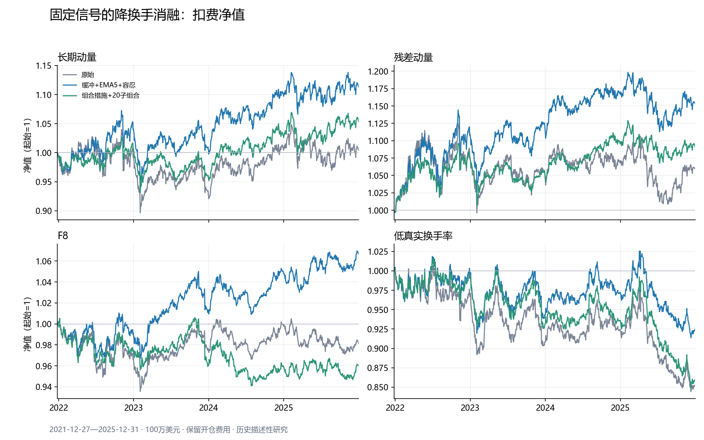

# 成本来源拆解与降换手研究（2026-10-23）

冻结参照：[阶段报告](STAGE_REPORT_2026-10-23.md)。本轮读取原有预测与因子，不重训、不变更方向，不改写历史产物。
窗口为 2021-12-27—2025-12-31，共 1,008 个交易日；起始资金 100 万美元；沿用基础成本、发行人/个股上限和全损退市假设。

残差动量的预先指定组合措施（缓冲带30%、EMA半衰期5日、目标偏差容忍20%）将净年化从 **1.46%** 改为 **3.64%**，日均单边换手从 **5.41%** 改为 **0.87%**。
这些是已经被审阅过的历史样本上的执行消融，不构成新的独立样本外盈利证据；没有按回测最大收益挑选最终参数。

## 1. 原始成本到底花在哪里

下表费用列为逐日费用/NAV的均值乘252，属于年化算术拖累；不应与复利CAGR差机械相加。信号、边界和漂移列是互斥的订单归因，另列借券。

| 因子 | 日单边换手 | 每成交美元成本bps | 每单位单边换手成本bps | 盈亏平衡bps/成交美元 | 信号/成分变化 | 边界代理 | 漂移/重分配 | 非调仓残单 | 借券 |
| --- | --- | --- | --- | --- | --- | --- | --- | --- | --- |
| 长期动量 | 5.45% | 13.52 | 27.03 | 13.86 | 0.07% | 1.74% | 1.90% | 0.00% | 0.25% |
| 残差动量 | 5.41% | 13.17 | 26.34 | 18.46 | 0.08% | 1.69% | 1.82% | 0.00% | 0.25% |
| F8 | 1.30% | 33.35 | 66.71 | 26.26 | 0.20% | 0.06% | 1.93% | 0.00% | 0.25% |
| 低真实换手率 | 3.39% | 17.41 | 34.82 | -5.88 | 0.04% | 1.04% | 1.89% | 0.00% | 0.25% |

- 单边换手 = 0.5 ×（买入成交额 + 卖出成交额）/扣借券后、扣交易费前NAV。现金日与开仓交易均保留。
- 单位成本bps = 总交易费/买卖成交额合计 × 10,000；该分母与单边换手差一个2，不能混用。
- 每单位单边换手成本按同一成交额加权口径为上述费率的2倍；另存的`*_summary_explicit_units.csv`同时输出这两种费率及对应的盈亏平衡门槛。
- 盈亏平衡bps：在记录的成交/毛收益路径上，以统一每成交美元费率替换交易费，借券保持不变，求期末净值=1的复利方程根。负值表示零交易费仍亏损；它不等于重新执行得到的成本门槛。
- 边界代理：发生进出、且相邻决策时点的排名都位于同侧外30%区间。它标识可观测的边界交易，不证明价格噪声或无效alpha。其余名单/方向变化归入信号/成分变化。
- 漂移/重分配：同方向目标权重变化、持仓价格/NAV漂移，以及前次成交后的实施偏差；方向相反的指令先净额抵消，再按同向贡献分配实际成交与费用。整股效应与价格漂移不能仅靠旧账本被唯一因果分离。
- 非调仓残单：只计原有执行器中非调仓日的残单重试成交费用；整股不足而拒单的费用为零。四条每日调仓因子的该项为零，不能引用别的策略最高25.2%的数值来解释它们。
- 子组合的费用按活跃子组合当日目标转换标签分组，属于记账约定；多个子组合净额抵消后的费用不能唯一因果归到某个信号事件。

全部 **76** 份历史账本均输出日度换手、单位成本、盈亏平衡与费用来源；包括两种退市假设、基础/双倍成本及原有固定基线/负对照。逐证券细节保留在本地授权数据目录。

小单诊断另按费用类型列示；最低佣金补差=`max(实际佣金−成交股数×每股佣金, 0)`，属于上述成本里的子集，不能重复加总。基础每股佣金为0.005美元，压力情景同步翻倍。

| 策略 | 成交订单数 | 成交额中位数 | 最低佣金补差年化拖累 |
| --- | --- | --- | --- |
| 长期动量 | 90,064 → 6,398 | $140 → $3,844 | 2.10% → 0.12% |
| F8 | 72,571 → 4,465 | $111 → $1,431 | 1.80% → 0.09% |
| 残差动量 | 91,967 → 6,342 | $141 → $4,186 | 1.99% → 0.11% |
| 低真实换手率 | 78,331 → 6,522 | $125 → $3,558 | 1.97% → 0.14% |
| price_only/lightgbm | 14,747 → 18,453 | $4,893 → $3,934 | 0.27% → 0.36% |
| price_only/ridge | 15,411 → 17,255 | $4,854 → $4,024 | 0.28% → 0.33% |
| price_plus_financial/lightgbm | 13,559 → 12,342 | $4,575 → $3,735 | 0.28% → 0.26% |
| price_plus_financial/ridge | 14,944 → 14,481 | $4,705 → $3,931 | 0.29% → 0.29% |

## 2. 固定组合措施与原策略比较

| 策略 | 原始净年化 | 组合措施净年化 | 组合措施双倍成本 | 日单边换手 | 年化交易拖累 | 最大净回撤 |
| --- | --- | --- | --- | --- | --- | --- |
| 长期动量 | 0.09% | 2.71% | 2.09% | 5.45% → 0.86% | 3.71% → 0.38% | -13.79% → -12.18% |
| F8 | -0.47% | 1.62% | 1.07% | 1.30% → 0.61% | 2.19% → 0.27% | -6.91% → -4.32% |
| 残差动量 | 1.46% | 3.64% | 2.97% | 5.41% → 0.87% | 3.59% → 0.37% | -11.43% → -10.33% |
| 低真实换手率 | -3.90% | -1.93% | -2.47% | 3.39% → 0.86% | 2.97% → 0.39% | -16.09% → -10.90% |
| price_only/lightgbm | 0.78% | -0.18% | -1.77% | 3.16% → 3.31% | 1.20% → 1.33% | -6.18% → -7.94% |
| price_only/ridge | 0.87% | 0.13% | -1.36% | 3.28% → 3.13% | 1.24% → 1.24% | -10.17% → -6.80% |
| price_plus_financial/lightgbm | -0.89% | -1.40% | -2.51% | 2.49% → 2.11% | 1.01% → 0.88% | -8.85% → -11.02% |
| price_plus_financial/ridge | -0.15% | 0.09% | -1.13% | 2.93% → 2.56% | 1.15% → 1.03% | -8.36% → -7.16% |

因子原始参照为每日调仓；模型原始参照为原来的20交易日一次调仓。模型的“每日对照”另列于完整消融表，EMA、缓冲与容忍带均与该每日对照比较才能隔离各自效果。
双倍成本是重新执行，佣金、滑点、冲击、卖出费用及借券一起翻倍，保留NAV与成交路径反馈。



## 3. 执行规则与解释边界

1. 缓冲带：进入多头须达到前20%，上次已入选的多头目标直到跌出前30%才退出；空头对称。这里的入选状态来自前次目标名单，实际成交仍由执行器决定。保留原平均排名的并列分数约定，名单数量可以变化，再做等权与原发行人/个股上限。调仓时缺失分数不续持；成分退出与终止处理保持显式。
2. EMA：直接平滑原预测输出，半衰期固定5/10个交易日，再排序；不读取标签。缺分数或离开预测股票池会重置该证券状态；OOF开始时初始化，没有虚构更早预测；模型折边界不使用未来数据预热。
3. 20个重叠子组合：首日同时建立全部子组合，之后每天只更新一个子组合，分配当日NAV的1/20。未更新的子组合按实际持仓与总收益漂移，并先内部抵消反向交易再对外净额成交。不会把过去20日的恒定目标权重简单平均后每天全组合再平衡，也不保证换手必然等于原来的1/20。
4. 子组合未成交量在当日收盘取消，下一轮轮到该子组合时重新决定；普通调仓路径保留原残单生命周期。该差异已记录在实验计划，流动性受限时不能将子组合结果解释为只改变调仓日历。
5. 容忍带：同方向持仓的目标偏差不超过目标绝对权重20%时不提交订单；新开仓、归零退出、反向换仓均不受此带阻挡。子组合在各自仓位上应用容忍带，成分退出对全部子组合生效。被抑制的候选记录为`suppressed_tolerance`且零费用，供审计使用。
6. 约束检验针对每次选出的单位子组合目标；非更新子组合与实际持仓允许漂移。完整表另列实际gross与净敞口极值，不能把目标约束说成每天实际敞口始终不漂移。

## 4. 全部固定参数消融

`combined`固定为缓冲30% + EMA5 + 容忍20%；`combined_tranche20`再增加20个子组合。EMA10是固定敏感性方案，不根据结果调整参数。各表保留全部失败/负收益结果。

| 策略 | 消融 | 毛年化 | 净年化 | 双倍成本净年化 | 日单边换手 | 单位成本bps | 盈亏平衡bps | 平均gross | 最大gross | 最大abs(net) |
| --- | --- | --- | --- | --- | --- | --- | --- | --- | --- | --- |
| 长期动量 | 原始 | 4.14% | 0.09% | -3.95% | 5.45% | 13.52 | 13.86 | 1.015 | 1.036 | 0.018 |
| 长期动量 | 容忍带20% | 4.42% | 2.23% | — | 5.05% | 7.35 | 16.02 | 1.010 | 1.081 | 0.041 |
| 长期动量 | 缓冲带30% | 3.35% | 0.11% | — | 1.97% | 29.54 | 30.68 | 1.015 | 1.043 | 0.024 |
| 长期动量 | EMA5 | 3.69% | 0.88% | — | 2.02% | 24.46 | 33.08 | 1.015 | 1.037 | 0.019 |
| 长期动量 | EMA10 | 3.59% | 0.92% | — | 1.65% | 28.35 | 39.32 | 1.015 | 1.037 | 0.018 |
| 长期动量 | 20个子组合 | 3.31% | 0.60% | — | 0.83% | 57.76 | 72.05 | 1.004 | 1.140 | 0.129 |
| 长期动量 | 缓冲+EMA5+容忍 | 3.36% | 2.71% | 2.09% | 0.86% | 8.72 | 70.56 | 1.010 | 1.088 | 0.053 |
| 长期动量 | 组合措施+20子组合 | 3.06% | 1.30% | -0.35% | 0.48% | 62.01 | 115.75 | 0.965 | 1.088 | 0.135 |
| F8 | 原始 | 2.00% | -0.47% | -2.89% | 1.30% | 33.35 | 26.26 | 1.016 | 1.041 | 0.019 |
| F8 | 容忍带20% | 1.92% | 1.29% | — | 0.91% | 8.14 | 35.92 | 1.010 | 1.090 | 0.084 |
| F8 | 缓冲带30% | 2.00% | -0.41% | — | 1.09% | 39.05 | 31.57 | 1.016 | 1.039 | 0.019 |
| F8 | EMA5 | 2.41% | 0.16% | — | 1.20% | 32.54 | 35.20 | 1.017 | 1.038 | 0.013 |
| F8 | EMA10 | 2.47% | 0.22% | — | 1.19% | 32.80 | 36.54 | 1.017 | 1.038 | 0.014 |
| F8 | 20个子组合 | 0.99% | -0.84% | — | 0.53% | 58.77 | 27.49 | 0.970 | 1.083 | 0.103 |
| F8 | 缓冲+EMA5+容忍 | 2.15% | 1.62% | 1.07% | 0.61% | 8.73 | 60.82 | 1.014 | 1.097 | 0.065 |
| F8 | 组合措施+20子组合 | 0.39% | -1.02% | -2.43% | 0.40% | 57.94 | 7.01 | 0.970 | 1.121 | 0.156 |
| 残差动量 | 原始 | 5.43% | 1.46% | -2.47% | 5.41% | 13.17 | 18.46 | 1.014 | 1.038 | 0.017 |
| 残差动量 | 容忍带20% | 5.83% | 3.66% | — | 5.01% | 7.20 | 21.45 | 1.011 | 1.088 | 0.042 |
| 残差动量 | 缓冲带30% | 4.63% | 1.47% | — | 1.94% | 28.76 | 43.65 | 1.013 | 1.038 | 0.023 |
| 残差动量 | EMA5 | 4.64% | 1.88% | — | 2.03% | 23.69 | 41.82 | 1.014 | 1.037 | 0.014 |
| 残差动量 | EMA10 | 4.66% | 2.02% | — | 1.68% | 27.24 | 50.92 | 1.014 | 1.036 | 0.014 |
| 残差动量 | 20个子组合 | 3.90% | 1.24% | — | 0.86% | 54.63 | 82.81 | 0.981 | 1.117 | 0.146 |
| 残差动量 | 缓冲+EMA5+容忍 | 4.29% | 3.64% | 2.97% | 0.87% | 8.45 | 90.36 | 1.006 | 1.092 | 0.055 |
| 残差动量 | 组合措施+20子组合 | 3.95% | 2.20% | 0.33% | 0.50% | 58.76 | 143.88 | 0.935 | 1.040 | 0.166 |
| 低真实换手率 | 原始 | -0.75% | -3.90% | -7.05% | 3.39% | 17.41 | -5.88 | 1.018 | 1.039 | 0.014 |
| 低真实换手率 | 容忍带20% | -0.50% | -1.88% | — | 3.01% | 7.57 | -4.95 | 1.017 | 1.091 | 0.034 |
| 低真实换手率 | 缓冲带30% | -0.80% | -3.73% | — | 1.70% | 32.03 | -12.33 | 1.017 | 1.045 | 0.020 |
| 低真实换手率 | EMA5 | -1.24% | -3.91% | — | 2.03% | 24.33 | -14.74 | 1.016 | 1.039 | 0.012 |
| 低真实换手率 | EMA10 | -1.48% | -4.01% | — | 1.62% | 28.71 | -21.44 | 1.017 | 1.040 | 0.010 |
| 低真实换手率 | 20个子组合 | -2.48% | -5.37% | — | 0.85% | 63.86 | -64.74 | 1.021 | 1.158 | 0.080 |
| 低真实换手率 | 缓冲+EMA5+容忍 | -1.30% | -1.93% | -2.47% | 0.86% | 9.04 | -36.27 | 1.020 | 1.089 | 0.050 |
| 低真实换手率 | 组合措施+20子组合 | -2.14% | -3.70% | -5.27% | 0.39% | 69.06 | -124.55 | 1.028 | 1.160 | 0.085 |
| price_only/lightgbm | 原始 | 2.25% | 0.78% | -0.70% | 3.16% | 7.52 | 12.37 | 1.013 | 1.144 | 0.032 |
| price_only/lightgbm | 每日对照 | 1.03% | -7.24% | — | 17.90% | 9.17 | 0.85 | 1.018 | 1.043 | 0.028 |
| price_only/lightgbm | 容忍带20% | 1.01% | -5.77% | — | 17.56% | 7.55 | 0.85 | 1.011 | 1.060 | 0.052 |
| price_only/lightgbm | 缓冲带30% | 0.79% | -6.21% | — | 11.40% | 12.05 | 0.93 | 1.015 | 1.043 | 0.034 |
| price_only/lightgbm | EMA5 | 0.75% | -3.12% | — | 5.48% | 13.28 | 1.80 | 1.020 | 1.046 | 0.020 |
| price_only/lightgbm | EMA10 | 1.86% | -1.51% | — | 3.99% | 15.49 | 7.90 | 1.018 | 1.040 | 0.018 |
| price_only/lightgbm | 20个子组合 | 0.65% | -4.58% | — | 1.91% | 53.22 | 4.63 | 0.791 | 0.979 | 0.172 |
| price_only/lightgbm | 缓冲+EMA5+容忍 | 1.41% | -0.18% | -1.77% | 3.31% | 7.96 | 6.89 | 1.005 | 1.094 | 0.059 |
| price_only/lightgbm | 组合措施+20子组合 | 0.31% | -3.57% | -7.66% | 1.25% | 59.18 | 1.40 | 0.856 | 0.997 | 0.173 |
| price_only/ridge | 原始 | 2.39% | 0.87% | -0.68% | 3.28% | 7.52 | 12.78 | 1.010 | 1.109 | 0.035 |
| price_only/ridge | 每日对照 | 1.41% | -7.30% | — | 19.29% | 8.96 | 1.17 | 1.018 | 1.046 | 0.024 |
| price_only/ridge | 容忍带20% | 1.33% | -6.04% | — | 18.98% | 7.61 | 1.11 | 1.012 | 1.063 | 0.036 |
| price_only/ridge | 缓冲带30% | 1.82% | -5.05% | — | 10.94% | 12.21 | 2.81 | 1.013 | 1.042 | 0.036 |
| price_only/ridge | EMA5 | 1.42% | -2.24% | — | 5.30% | 12.84 | 4.33 | 1.018 | 1.041 | 0.017 |
| price_only/ridge | EMA10 | 2.31% | -0.87% | — | 3.87% | 14.90 | 10.42 | 1.018 | 1.039 | 0.015 |
| price_only/ridge | 20个子组合 | 2.06% | -3.49% | — | 1.98% | 53.45 | 18.18 | 0.854 | 1.006 | 0.169 |
| price_only/ridge | 缓冲+EMA5+容忍 | 1.64% | 0.13% | -1.36% | 3.13% | 7.88 | 8.73 | 1.007 | 1.101 | 0.059 |
| price_only/ridge | 组合措施+20子组合 | 2.40% | -1.63% | -6.11% | 1.26% | 59.39 | 33.74 | 0.881 | 1.041 | 0.152 |
| price_plus_financial/lightgbm | 原始 | 0.37% | -0.89% | -2.17% | 2.49% | 8.01 | 0.89 | 1.011 | 1.140 | 0.077 |
| price_plus_financial/lightgbm | 每日对照 | 0.13% | -6.45% | — | 13.43% | 9.68 | -0.18 | 1.012 | 1.038 | 0.023 |
| price_plus_financial/lightgbm | 容忍带20% | 0.14% | -4.99% | — | 13.11% | 7.57 | -0.18 | 1.007 | 1.060 | 0.058 |
| price_plus_financial/lightgbm | 缓冲带30% | 0.09% | -5.27% | — | 7.52% | 13.86 | -0.43 | 1.011 | 1.046 | 0.031 |
| price_plus_financial/lightgbm | EMA5 | 0.40% | -2.83% | — | 3.92% | 15.26 | 0.72 | 1.014 | 1.035 | 0.023 |
| price_plus_financial/lightgbm | EMA10 | 0.15% | -2.71% | — | 2.83% | 18.46 | -0.75 | 1.014 | 1.035 | 0.021 |
| price_plus_financial/lightgbm | 20个子组合 | 0.57% | -3.88% | — | 1.48% | 57.59 | 4.59 | 0.885 | 1.005 | 0.118 |
| price_plus_financial/lightgbm | 缓冲+EMA5+容忍 | -0.27% | -1.40% | -2.51% | 2.11% | 8.24 | -4.97 | 1.008 | 1.077 | 0.059 |
| price_plus_financial/lightgbm | 组合措施+20子组合 | -0.20% | -3.08% | -5.95% | 0.82% | 64.90 | -10.60 | 0.917 | 1.049 | 0.120 |
| price_plus_financial/ridge | 原始 | 1.26% | -0.15% | -1.63% | 2.93% | 7.78 | 6.74 | 1.012 | 1.100 | 0.036 |
| price_plus_financial/ridge | 每日对照 | 0.39% | -7.52% | — | 17.08% | 9.23 | 0.15 | 1.017 | 1.039 | 0.028 |
| price_plus_financial/ridge | 容忍带20% | 0.32% | -6.21% | — | 16.78% | 7.65 | 0.08 | 1.010 | 1.058 | 0.055 |
| price_plus_financial/ridge | 缓冲带30% | 0.85% | -5.34% | — | 9.26% | 13.03 | 1.27 | 1.012 | 1.040 | 0.033 |
| price_plus_financial/ridge | EMA5 | 1.55% | -1.90% | — | 4.64% | 13.67 | 5.49 | 1.017 | 1.041 | 0.021 |
| price_plus_financial/ridge | EMA10 | 1.94% | -1.04% | — | 3.29% | 16.31 | 10.02 | 1.018 | 1.045 | 0.019 |
| price_plus_financial/ridge | 20个子组合 | 1.06% | -3.96% | — | 1.70% | 56.69 | 9.79 | 0.869 | 1.008 | 0.152 |
| price_plus_financial/ridge | 缓冲+EMA5+容忍 | 1.38% | 0.09% | -1.13% | 2.56% | 7.99 | 8.69 | 1.006 | 1.105 | 0.053 |
| price_plus_financial/ridge | 组合措施+20子组合 | 0.99% | -2.30% | -5.64% | 0.96% | 63.70 | 15.70 | 0.895 | 1.060 | 0.153 |

## 5. 平滑是否损失排序信息

| 策略 | 原分数20日Rank IC | EMA5的20日Rank IC | EMA10的20日Rank IC | 配对有标签行 |
| --- | --- | --- | --- | --- |
| 长期动量 | 0.02541 | 0.02628 | 0.02730 | 494886 |
| F8 | 0.00880 | 0.00826 | 0.00806 | 442585 |
| 残差动量 | 0.02995 | 0.03065 | 0.03146 | 491407 |
| 低真实换手率 | 0.01257 | 0.01187 | 0.01103 | 496687 |
| price_only/lightgbm | 0.00881 | 0.00996 | 0.01047 | 496687 |
| price_only/ridge | 0.01001 | 0.01458 | 0.01819 | 496687 |
| price_plus_financial/lightgbm | 0.00773 | 0.00947 | 0.00952 | 496687 |
| price_plus_financial/ridge | 0.00717 | 0.01137 | 0.01349 | 496687 |

IC只在原有可用20日标签上作描述性统计，标签从不参与目标构造；不能预先假设慢信号平滑一定不损失IC。标签读取冻结的价量模型OOF文件，按共同日期/证券键一对一关联到已完成的因子与模型分数，未重新计算或改变标签口径。各平滑分支的缺失掩码与原分数一致；数值只代表此1,008日窗口，不能与阶段报告2010—2025的IC混为同一统计窗口。

## 6. 验证、产物与复现

- 原始策略重放关闭全部降换手控制后，与八份冻结参照NAV逐日核对，最大允许相对误差为1e-10。
- 每份账本验证净值会计恒等式、来源费用加总、成交参与率、整股成交与目标权重上限；单元测试覆盖EMA前缀不变、缺失/退出、缓冲留仓、新开/归零/反向豁免、残单带内取消、子组合内部净额与部分成交、非更新子组合漂移、复利盈亏平衡求根。
- 本次全工作区测试：496项通过，45条warning。经济效果与测试通过分别评价。
- 没有独立重建股数/现金/公司行为账本，没有验证真实借券可得性或重新建立容量证据，`production_admitted=false`。
- 新实验记录dirty源码状态及完整源码快照、输入SHA-256；没有将未提交代码的结果声明为仅凭当前Git提交即可复现。

本地产物：`data/wrds/batch2/turnover_optimization_20261023`与`data/wrds/batch2/turnover_optimization_20261023_stress`。前者包含`recorded_strategy_summary.csv`、`replay_summary.csv`，各策略下有`daily_turnover_costs.csv`、`cost_sources.csv`、执行账本、目标与平滑分数；后者保存双倍成本回放。`experiment_plan.json`和`completion.json`记录全部尝试与完成状态。

```powershell
python scripts/optimize_wrds_turnover.py --phase all --jobs 4 --output data/wrds/batch2/turnover_new_run
python scripts/optimize_wrds_turnover.py --phase replay --variants baseline combined combined_tranche20 --cost-multipliers 2 --jobs 2 --output data/wrds/batch2/turnover_new_stress
python scripts/report_wrds_turnover.py --experiment data/wrds/batch2/turnover_new_run --stress data/wrds/batch2/turnover_new_stress
python -m pytest -q
```

输出目录必须是新目录，避免覆盖既有证据。源码快照保存在各实验的`source_snapshot/`，输入授权数据不随公开仓库分发。
